# Практическая работа 1 · Подготовка окружения

Развёртывание RTL-модели OpenTitan Earl Grey в Verilator и запуск Zephyr RTOS на компьютере Mac с процессором Apple Silicon.

[К списку практических работ](../../README.md)

## Паспорт работы

| Параметр | Значение |
| --- | --- |
| Исполнители | Груздев И., Гошин А., группа ИУ10-95 |
| Хост | MacBook Pro, Apple Silicon (arm64), 16 ГБ RAM, macOS 15 |
| Виртуальная машина | lima 2.2.1, Ubuntu 24.04 arm64, 8 vCPU, 12 ГБ RAM, 8 ГБ swap, диск 200 ГБ |
| Рабочее окружение | Docker-контейнер Ubuntu 24.04 x86_64, выполняется через Rosetta 2 |
| OpenTitan | ветка `earlgrey_1.0.0`, коммит `4aacad7540` |
| RISC-V toolchain | lowRISC `20250710-1` (GCC 10.2.0) |
| Verilator | 4.210 |
| Bazel | 8.7.0 (через `bazelisk.sh`) |
| Zephyr RTOS | 3.7.0 |
| Zephyr SDK | 0.16.8 (GCC 12.2.0) |
| Целевая плата | `opentitan_earlgrey` |
| Результаты | UART smoke test — `PASSED`; Zephyr — `Hello World!` |

## Навигация

- [Цель работы](#s01)
- [OpenTitan и Verilator](#s02)
- [Схема стенда](#s03)
- [Виртуальная машина](#s04)
- [Исходный код OpenTitan](#s05)
- [Почему понадобился x86-контейнер](#s08)
- [Контейнер и зависимости](#s09)
- [RISC-V toolchain](#s11)
- [Сборка Verilator](#s12)
- [UART smoke test](#s14)
- [Установка Zephyr](#s16)
- [Сборка Hello World](#s20)
- [Запуск в модели](#s21)
- [Результат](#s22)
- [Проблемы и решения](#s23)
- [Заключение](#s24)

<a id="s01"></a>

## 1. Цель работы

Цель работы — подготовить окружение для программного моделирования аппаратного корня доверия OpenTitan и убедиться, что внутри модели выполняется операционная система реального времени Zephyr.

Задачи:

1. Разобраться, что такое OpenTitan и зачем нужен Verilator.
2. Подготовить Linux-окружение на компьютере Mac с процессором ARM.
3. Получить исходный код OpenTitan версии `earlgrey_1.0.0`.
4. Установить системные и Python-зависимости, RISC-V toolchain и Verilator 4.210.
5. Собрать RTL-модель чипа и выполнить штатный тест `uart_smoketest`.
6. Установить Zephyr RTOS 3.7.0 и Zephyr SDK 0.16.8.
7. Собрать приложение `hello_world` для платы `opentitan_earlgrey`.
8. Запустить Zephyr в модели OpenTitan и получить вывод `Hello World!` через UART.

---

<a id="s02"></a>

## 2. OpenTitan и Verilator

**OpenTitan** — открытый проект аппаратного корня доверия (Hardware Root of Trust, RoT). Корень доверия — небольшой защищённый чип, который первым получает управление при включении устройства. Он проверяет подлинность остального программного обеспечения, хранит ключи и выполняет криптографические операции.

В работе используется вариант **Earl Grey** — микроконтроллер OpenTitan, в который входят:

* процессорное ядро **Ibex** (RISC-V, 32 бита, набор инструкций RV32IMCB, режимы Machine и User);
* защита памяти **ePMP**;
* криптографические блоки (AES, HMAC, KMAC, OTBN), генератор случайных чисел;
* память ROM, OTP, флеш и SRAM;
* периферия: UART, GPIO, SPI, USB.

OpenTitan — это **аппаратная платформа**, а не операционная система. В этой работе на ней выполняется Zephyr RTOS, а Zephyr запускает приложение.

Физического чипа нет, поэтому используется **Verilator**. Он переводит описание аппаратуры на SystemVerilog (RTL) в программу на C++. После компиляции получается исполняемый файл `Vchip_sim_tb`. Это потактовая модель чипа: она выполняет ту же логику, что и настоящий кристалл, только в тысячи раз медленнее.

---

<a id="s03"></a>

## 3. Схема стенда

Компьютер для работы — MacBook на процессоре Apple Silicon (архитектура arm64). Инструменты сборки OpenTitan рассчитаны на Linux x86_64, поэтому стенд получился трёхуровневым:

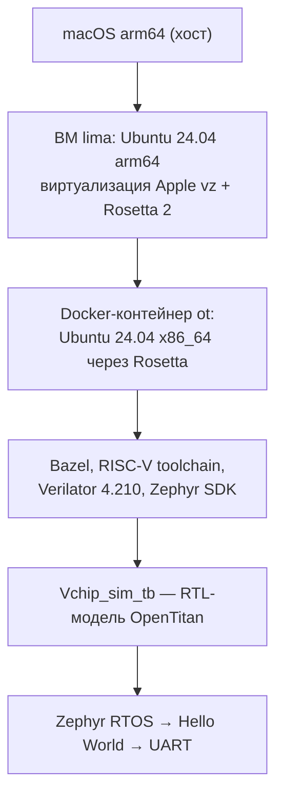

* **Виртуальная машина lima** даёт Linux. Она работает на родной архитектуре ARM, поэтому почти без потерь скорости.
* **Rosetta 2** — транслятор Apple, который на лету выполняет программы x86_64 на процессоре ARM. Внутри ВМ он подключён как интерпретатор x86-программ (механизм `binfmt_misc`).
* **Docker-контейнер x86_64** нужен потому, что сборочная система OpenTitan отказывается работать на ARM (подробно в [разделе 8](#s08)). Изнутри контейнер выглядит как обычный компьютер x86_64.

Каталог `~/work` виртуальной машины подключён в контейнер как `/work`. В нём лежат исходники OpenTitan, Zephyr и собранные файлы.

---

<a id="s04"></a>

## 4. Виртуальная машина

Сначала на Mac был установлен Rosetta 2:

```bash
softwareupdate --install-rosetta --agree-to-license
```

Затем создана виртуальная машина lima:

```bash
limactl create --name=opentitan --vm-type=vz --rosetta --cpus=8 --memory=12 --disk=200 --mount-none template:ubuntu-24.04
```

| Параметр | Назначение |
| --- | --- |
| `--vm-type=vz` | встроенная виртуализация macOS (Virtualization.framework); без неё Rosetta в ВМ не подключить |
| `--rosetta` | x86-программы внутри Linux выполняются через Rosetta |
| `--cpus=8 --memory=12` | компиляция RTL-модели в Verilator требует много памяти и процессорного времени |
| `--disk=200` | по заданию нужно около 150 ГБ; диск занимает место по мере заполнения |
| `--mount-none` | ВМ не получает доступа к домашней папке Mac, вся работа идёт внутри Linux |
| `template:ubuntu-24.04` | та же версия Ubuntu, что указана в методических материалах |

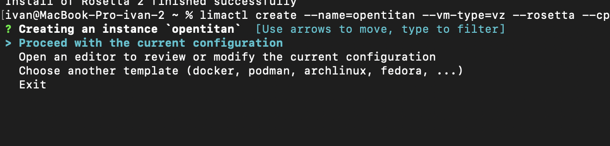

*Рисунок 1 — Установка Rosetta 2 и подтверждение конфигурации виртуальной машины*

Строка `Package Authoring Error … installKBytes` при установке Rosetta — предупреждение установщика Apple; установка завершилась сообщением `Install of Rosetta 2 finished successfully`.

ВМ запущена, затем проверены её ресурсы:

```bash
limactl start opentitan
limactl shell opentitan
uname -m; nproc; free -h; df -h ~; cat /proc/sys/fs/binfmt_misc/rosetta 2>/dev/null | head -2
```

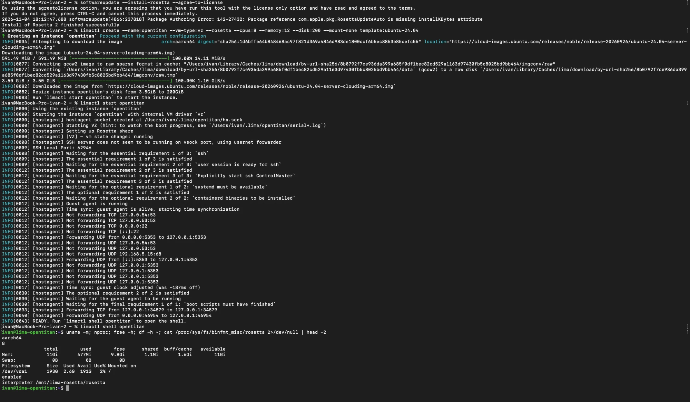

*Рисунок 2 — Запуск виртуальной машины и проверка архитектуры, памяти, диска и Rosetta*

Результат проверки:

* архитектура `aarch64` — Linux работает на ARM без эмуляции;
* 8 процессоров, около 11 ГиБ памяти, 191 ГБ свободного места;
* `enabled` и `interpreter /mnt/lima-rosetta/rosetta` — Rosetta зарегистрирован как интерпретатор x86_64-программ.

---

<a id="s05"></a>

## 5. Swap и исходный код OpenTitan

Swap — область на диске, которую Linux использует как дополнительную память, когда заканчивается оперативная. Это медленно, но компилятор не будет аварийно завершён из-за нехватки памяти. Компиляция модели чипа — одна из самых тяжёлых операций работы, поэтому создан swap-файл на 8 ГБ:

```bash
sudo fallocate -l 8G /swapfile && sudo chmod 600 /swapfile && sudo mkswap /swapfile && sudo swapon /swapfile
echo '/swapfile none swap sw 0 0' | sudo tee -a /etc/fstab
```

Запись в `/etc/fstab` включает swap автоматически после перезапуска ВМ.

Исходный код OpenTitan получен сразу в нужной ветке:

```bash
mkdir -p ~/work && cd ~/work && git clone -b earlgrey_1.0.0 https://github.com/lowRISC/opentitan.git
cd ~/work/opentitan && git branch --show-current && git log -1 --oneline
```

`earlgrey_1.0.0` — ветка первого стабильного выпуска Earl Grey. Под неё подобрана поддержка платы в Zephyr 3.7.0. Репозиторий клонирован с полной историей: сборочные скрипты OpenTitan читают сведения из git.

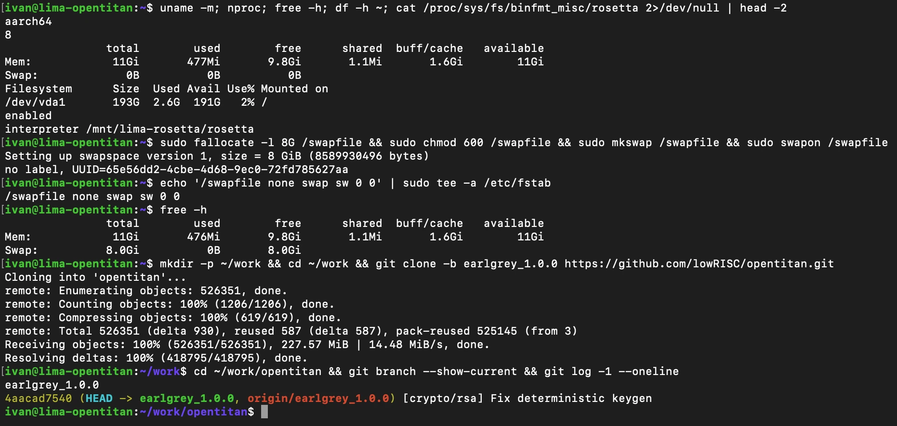

*Рисунок 3 — Включение swap 8 ГБ, клонирование OpenTitan и проверка ветки и коммита*

Работа велась на коммите `4aacad7540` («[crypto/rsa] Fix deterministic keygen»). Ветка `earlgrey_1.0.0` получает исправления, поэтому коммит записан как точная версия исходников.

---

<a id="s06"></a>

## 6. Системные зависимости в ВМ

Список системных пакетов OpenTitan хранится в файле `apt-requirements.txt`:

```bash
sudo apt update
sed '/^#/d;/^$/d;s/^libncursesw5$/libncursesw6/' apt-requirements.txt | xargs sudo apt install -y python3-venv
```

* `sed` убирает из списка комментарии и пустые строки и заменяет пакет `libncursesw5`, которого нет в Ubuntu 24.04, на `libncursesw6`;
* `xargs` передаёт получившийся список в `apt install`;
* `python3-venv` добавлен вручную: в облачном образе Ubuntu его нет, а он нужен для создания Python-окружения.

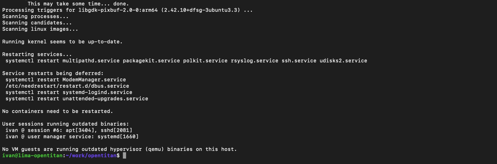

*Рисунок 4 — Завершение установки системных зависимостей OpenTitan в виртуальной машине*

Установка завершилась без ошибок. Сообщение `Restarting services… outdated binaries` — штатное уведомление Ubuntu после обновления библиотек.

---

<a id="s07"></a>

## 7. Python-окружение в ВМ

Инструменты OpenTitan в основном написаны на Python: FuseSoC (формирует список RTL-файлов для Verilator), генераторы регистров, скрипты тестов. Они устанавливаются в изолированное виртуальное окружение `.venv`, чтобы не смешиваться с системным Python:

```bash
sudo apt install -y python3-dev
python3 -m venv .venv && source .venv/bin/activate
pip install -U pip
pip install -r python-requirements.txt --require-hashes
```

Ключ `--require-hashes` заставляет pip сверять контрольную сумму каждого пакета с записанной в файле. Так устанавливаются ровно те версии, которые зафиксировали разработчики, и подмена пакета будет обнаружена.

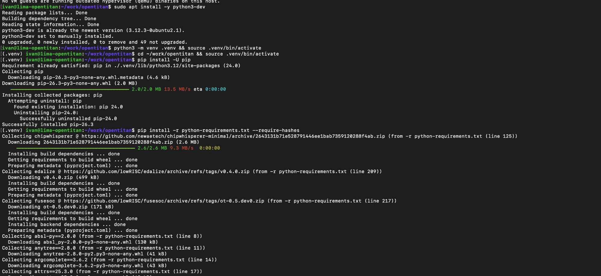

*Рисунок 5 — Создание окружения `.venv`, обновление pip и начало установки Python-зависимостей OpenTitan*

Старый `setuptools` из списка зависимостей несовместим с Python 3.12 из Ubuntu 24.04 и приводит к ошибке `module 'pkgutil' has no attribute 'ImpImporter'`. Чтобы её избежать, `setuptools` сразу обновлён:

```bash
pip install "setuptools>=68,<81"
python3 -c "import setuptools, fusesoc; print('setuptools', setuptools.__version__); print('fusesoc ok')"
```

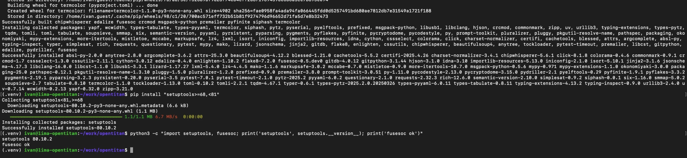

*Рисунок 6 — Завершение установки зависимостей, обновление setuptools до 80.10.2 и проверка FuseSoC*

Получено `setuptools 80.10.2` и `fusesoc ok`: Python-окружение работает. Все пакеты собрались под ARM.

---

<a id="s08"></a>

## 8. Почему понадобился x86-контейнер

Перед сборкой модели была проверена конфигурация Bazel — системы сборки OpenTitan. Выяснилось, что в `earlgrey_1.0.0` сборка на ARM невозможна:

* в `toolchain/BUILD` RISC-V toolchain объявлен с ограничением `exec_compatible_with = ["@platforms//cpu:x86_64"]`, то есть его можно запускать только на x86_64;
* Rust-тулчейны в `MODULE.bazel` объявлены только для `x86_64-unknown-linux-gnu`;
* компилятор lowRISC в `third_party/lowrisc/extensions.bzl` скачивается только в варианте x86_64.

На ARM-машине Bazel сообщит, что подходящего тулчейна нет, ещё до запуска каких-либо программ. Rosetta здесь не поможет: Bazel определяет архитектуру хоста и отказывается раньше.

Решение — Docker-контейнер Ubuntu 24.04 для платформы `linux/amd64` внутри ВМ. Его программы выполняются через Rosetta (в ВМ Rosetta зарегистрирован с флагом `F`, который нужен для работы внутри контейнеров). Для Bazel контейнер выглядит как обычный x86_64-компьютер.

Python-окружение из [раздела 7](#s07) собрано под ARM, поэтому его пришлось пересоздать внутри контейнера. Системные пакеты, установленные в ВМ, не мешают и были оставлены.

---

<a id="s09"></a>

## 9. Docker и x86-контейнер

Docker установлен в ВМ, пользователь добавлен в группу `docker`, чтобы запускать контейнеры без `sudo`:

```bash
sudo apt install -y docker.io && sudo usermod -aG docker $USER
```

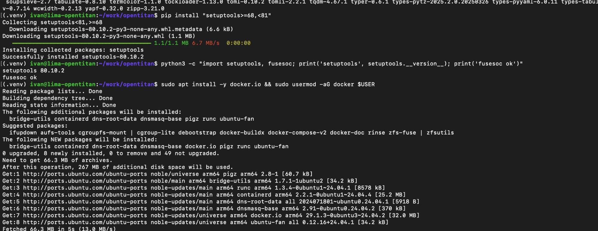

*Рисунок 7 — Установка Docker (docker.io 29.1.3) в виртуальной машине*

Проверка запуска x86-контейнера:

```bash
docker run --rm --platform linux/amd64 ubuntu:24.04 uname -m
```

Без `sudo` команда завершилась ошибкой `permission denied`, с `sudo` — вывела `x86_64`.

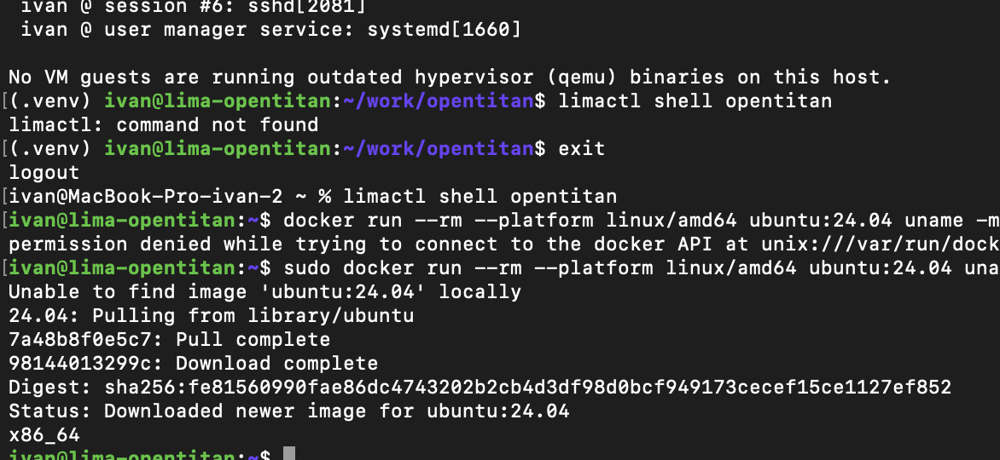

*Рисунок 8 — Ошибка доступа к Docker без sudo и успешный запуск x86_64-контейнера через Rosetta*

Ошибка возникла потому, что новая группа применяется только при новом входе в систему. lima держит постоянное SSH-подключение к ВМ (ControlMaster) и переиспользует его, поэтому `exit` и повторный `limactl shell` не создают нового входа. Решение — перезапустить ВМ с хоста:

```bash
getent group docker
limactl stop opentitan && limactl start opentitan
limactl shell opentitan
free -h | grep Swap; docker run --rm --platform linux/amd64 ubuntu:24.04 uname -m
```

(Команда `limactl` существует только на Mac, внутри ВМ она выдаёт `command not found`.)

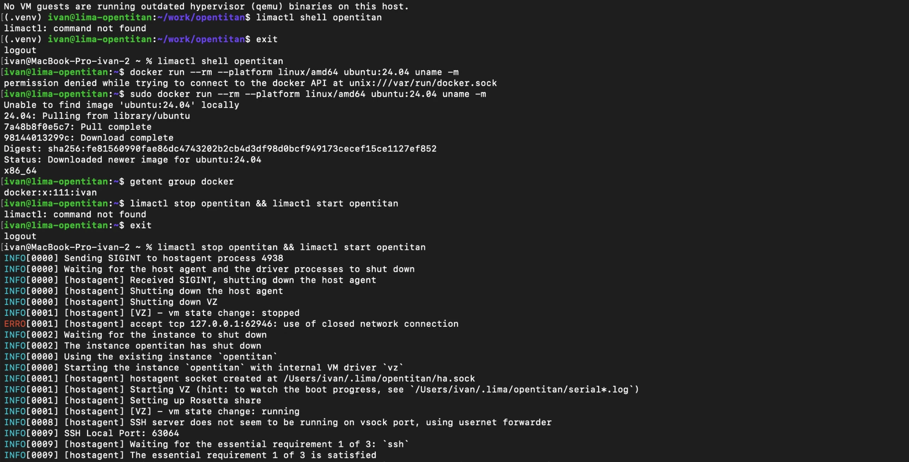

*Рисунок 9 — Проверка группы docker, перезапуск ВМ и запуск x86_64-контейнера без sudo*

После перезапуска контейнер запустился без `sudo`, а swap 8 ГБ сохранился.

Создан рабочий контейнер `ot`:

```bash
docker run -d --name ot --platform linux/amd64 --hostname ot-x86 -v ~/work:/work ubuntu:24.04 sleep infinity
docker exec ot bash -c 'apt update && apt install -y sudo git && useradd -m -u 501 -s /bin/bash ivan && echo "ivan ALL=(ALL) NOPASSWD:ALL" > /etc/sudoers.d/ivan'
docker exec -it -u ivan -w /work/opentitan ot bash
```

| Параметр | Назначение |
| --- | --- |
| `-d --name ot` | контейнер работает в фоне под именем `ot` |
| `--platform linux/amd64` | образ Ubuntu для x86_64 |
| `-v ~/work:/work` | каталог `~/work` ВМ доступен в контейнере как `/work` |
| `sleep infinity` | контейнер не завершается, в него можно входить командой `docker exec` |
| `useradd -u 501` | пользователь `ivan` с тем же UID, что в ВМ, чтобы не было конфликтов прав на файлы в `/work` |

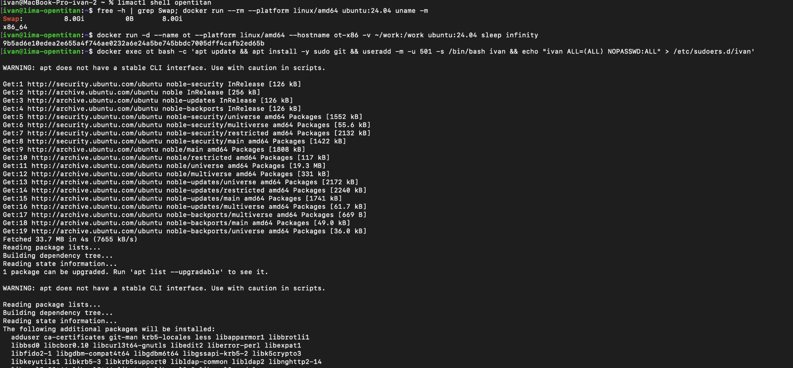

*Рисунок 10 — Создание x86_64-контейнера `ot` и пользователя ivan*

Предупреждение `useradd warning: … uid 501 outside of UID_MIN` безвредно: в Ubuntu номера обычных пользователей принято начинать с 1000.

---

<a id="s10"></a>

## 10. Зависимости OpenTitan в контейнере

Внутри контейнера установка системных пакетов и Python-окружения повторена:

```bash
rm -rf .venv && sudo apt update
sed '/^#/d;/^$/d;s/^libncursesw5$/libncursesw6/' apt-requirements.txt | xargs sudo DEBIAN_FRONTEND=noninteractive apt install -y python3-venv python3-dev
python3 -m venv .venv && source .venv/bin/activate && pip install -U pip
pip install -r python-requirements.txt --require-hashes && pip install "setuptools>=68,<81"
uname -m; python3 -c "import setuptools, fusesoc; print('fusesoc ok')"
```

`DEBIAN_FRONTEND=noninteractive` нужен потому, что без него пакет часовых поясов `tzdata` остановит установку в контейнере и будет ждать выбора города.

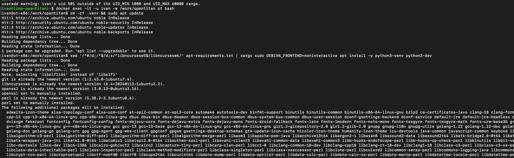

*Рисунок 11 — Установка системных зависимостей OpenTitan в x86_64-контейнере*

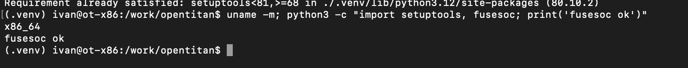

*Рисунок 12 — Проверка: архитектура `x86_64`, FuseSoC импортируется*

---

<a id="s11"></a>

## 11. RISC-V toolchain

Процессор Ibex имеет архитектуру RISC-V, поэтому программы для него собираются **кросс-компилятором**: он работает на x86_64, а выдаёт код для RISC-V.

Штатный скрипт `util/get-toolchain.py` выбирает первый подходящий архив из выпуска lowRISC. Сейчас в выпусках есть архивы и для x86_64, и для aarch64, и скрипт мог скачать не тот. Поэтому архив той же версии, что указана в `third_party/lowrisc/extensions.bzl` (`20250710-1`), скачан вручную:

```bash
mkdir -p ~/ot_tools/riscv && curl -L https://github.com/lowRISC/lowrisc-toolchains/releases/download/20250710-1/lowrisc-toolchain-rv32imcb-x86_64-20250710-1.tar.xz | tar -xJ -C ~/ot_tools/riscv --strip-components=1
echo 'export TOOLCHAIN_PATH="$HOME/ot_tools/riscv"; export PATH="$TOOLCHAIN_PATH/bin:/tools/verilator/4.210/bin:$PATH"' >> ~/.bashrc && source ~/.bashrc
riscv32-unknown-elf-gcc --version | head -1
```

`rv32imcb` в имени архива — набор расширений Ibex: целочисленные операции (I), умножение и деление (M), сжатые 16-битные инструкции (C), битовые операции (B).

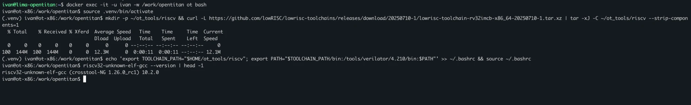

*Рисунок 13 — Загрузка и проверка RISC-V toolchain lowRISC (GCC 10.2.0)*

---

<a id="s12"></a>

## 12. Сборка Verilator 4.210

OpenTitan `earlgrey_1.0.0` поддерживает Verilator 4.210. В Ubuntu 24.04 есть только Verilator 5.x, поэтому нужная версия собрана из исходников. Verilator 4.210 не компилируется свежим GCC 13, поэтому для сборки использован GCC 11:

```bash
sudo apt install -y gcc-11 g++-11 autoconf flex bison libfl2 libfl-dev help2man
```

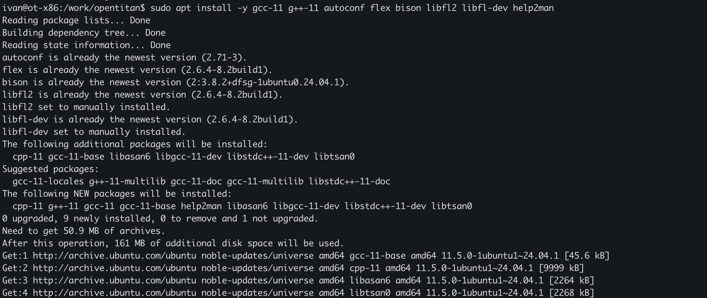

*Рисунок 14 — Установка GCC 11 и инструментов для сборки Verilator*

```bash
mkdir -p ~/src && cd ~/src && git clone https://github.com/verilator/verilator.git && cd verilator && git checkout v4.210
```

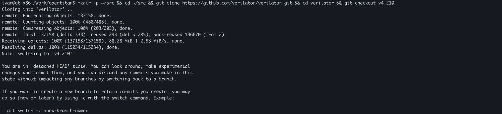

*Рисунок 15 — Клонирование исходного кода Verilator и переключение на тег v4.210*

```bash
autoconf && CC=gcc-11 CXX=g++-11 ./configure --prefix=/tools/verilator/4.210
CC=gcc-11 CXX=g++-11 make -j6 && sudo make install
```

* `autoconf` генерирует скрипт `configure`;
* `configure` проверяет систему и готовит сборку, `--prefix` задаёт каталог установки;
* `make -j6` собирает в 6 потоков, `make install` копирует результат в `/tools/verilator/4.210`.

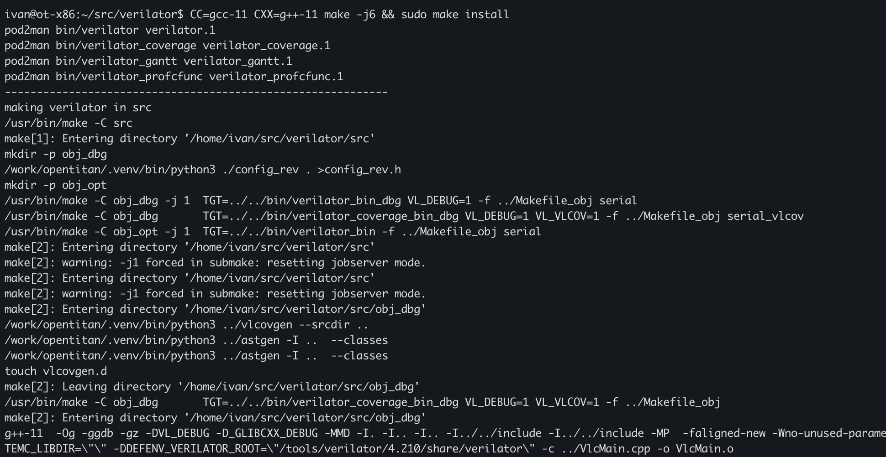

*Рисунок 16 — Компиляция и установка Verilator*

```bash
cd /work/opentitan && verilator --version
```

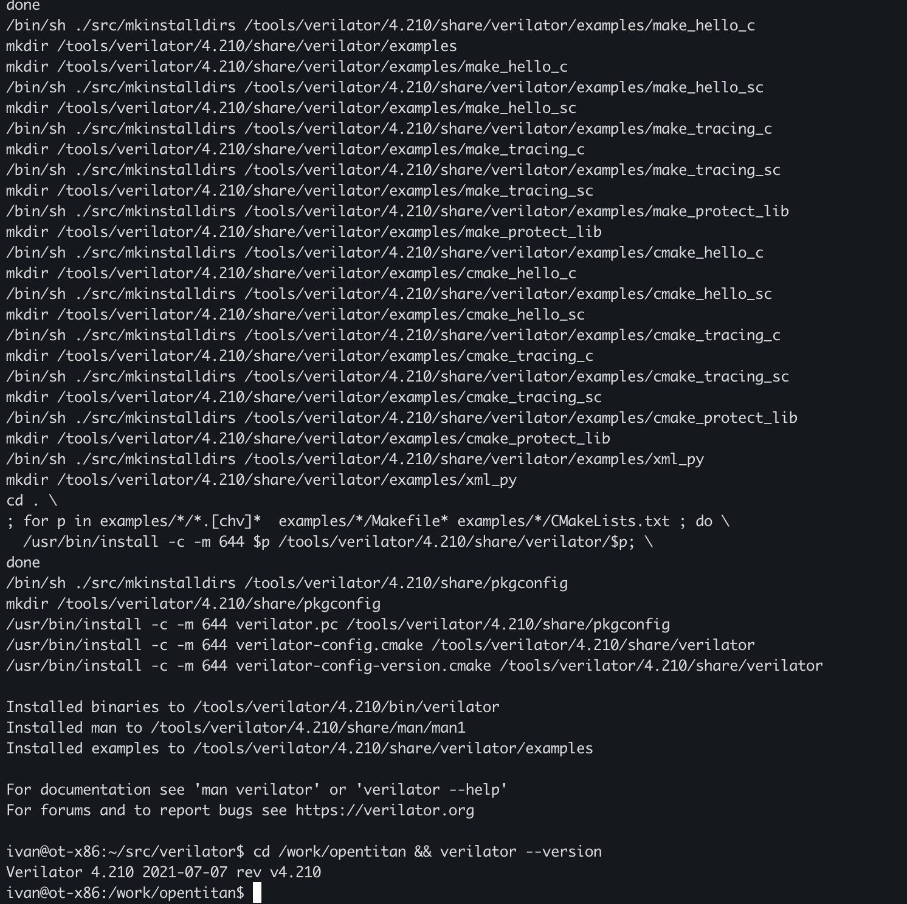

*Рисунок 17 — Проверка версии: Verilator 4.210 2021-07-07*

Python-окружение OpenTitan подключено в `~/.bashrc`, чтобы включаться при каждом входе в контейнер:

```bash
echo 'source /work/opentitan/.venv/bin/activate' >> ~/.bashrc && source ~/.bashrc
```

---

<a id="s13"></a>

## 13. Библиотека `libtinfo5`

Bazel скачивает готовую `libclang`, которая собрана с библиотекой терминала `libtinfo.so.5`. В Ubuntu 24.04 этой версии библиотеки нет, и сборка падает с ошибкой `libtinfo.so.5: cannot open shared object file`. Чтобы её избежать, пакет установлен заранее из Ubuntu 22.04:

```bash
cd /tmp && curl -LO http://archive.ubuntu.com/ubuntu/pool/universe/n/ncurses/libtinfo5_6.3-2ubuntu0.3_amd64.deb && sudo apt install -y ./libtinfo5_6.3-2ubuntu0.3_amd64.deb && cd /work/opentitan
```

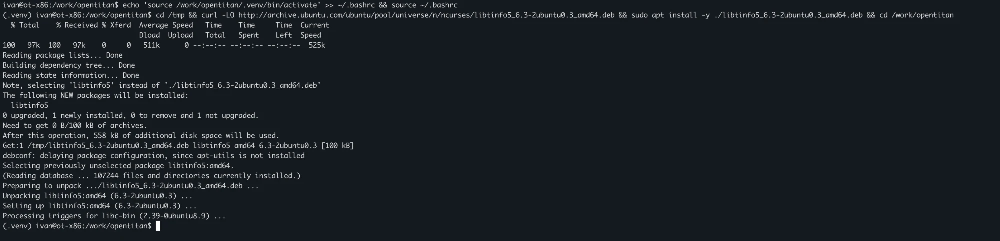

*Рисунок 18 — Установка библиотеки libtinfo5 из репозитория Ubuntu 22.04*

---

<a id="s14"></a>

## 14. UART smoke test

### 14.1. Связь компонентов


Verilator отвечает за **аппаратную модель**, RISC-V toolchain — за **программы, которые выполняются внутри неё**. Bazel связывает всё в одну цепочку сборки.

### 14.2. Запуск теста

```bash
./bazelisk.sh test --test_output=streamed --jobs=4 --test_timeout=1800 //sw/device/tests:uart_smoketest_sim_verilator
```

| Параметр | Назначение |
| --- | --- |
| `./bazelisk.sh` | скачивает Bazel версии из `.bazelversion` (8.7.0) и запускает его |
| `//sw/device/tests:uart_smoketest_sim_verilator` | цель: собрать модель, test ROM, OTP и тест, запустить тест в Verilator |
| `--test_output=streamed` | выводить сообщения теста сразу |
| `--jobs=4` | 4 параллельные задачи |
| `--test_timeout=1800` | 30 минут на выполнение теста: под Rosetta модель работает медленнее |

Smoke test — минимальная проверка: собирается ли модель, загружается ли программа, выполняет ли её процессор и выводит ли результат через UART.

### 14.3. Ошибка configure у libelf

Первый запуск завершился ошибкой при сборке библиотеки `libelf` (elfutils 0.195), которую Bazel собирает из исходников:

```text
config.status: error: Something went wrong bootstrapping makefile fragments
for automatic dependency tracking.
```

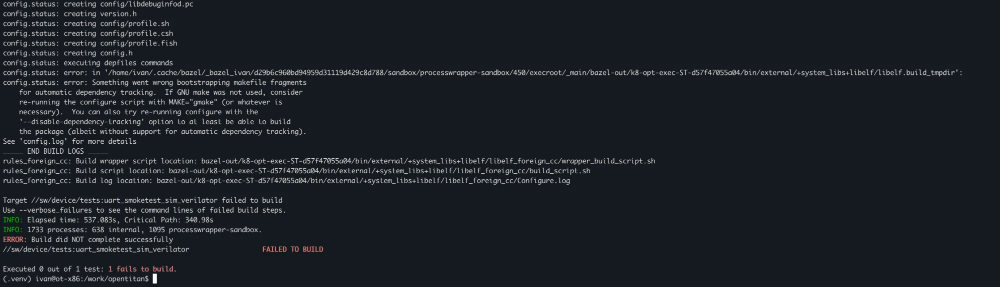

*Рисунок 19 — Ошибка configure при сборке elfutils (libelf)*

Проверка показала:

* тот же шаг `configure` вне песочницы Bazel проходит без ошибок;
* отдельная сборка только этой библиотеки (`./bazelisk.sh build @@+system_libs+libelf//:libelf`) прошла успешно за 281 с;
* в журнале ядра нет признаков нехватки памяти (OOM).

Вывод: это случайный сбой при параллельной сборке через Rosetta. Повторный запуск продолжил сборку с места остановки: уже собранные части Bazel берёт из кэша.

### 14.4. Verilator не найден в песочнице Bazel

Второй запуск завершился другой ошибкой:

```text
ERROR: Failed tool requirement for verilator: Unable to call Verilator to check version:
Command 'verilator --version' returned non-zero exit status 127.
```

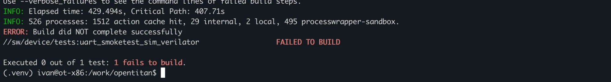

*Рисунок 20 — Bazel не находит Verilator при проверке версии*

Код 127 означает «команда не найдена». В `.bazelrc` OpenTitan включён режим `build --incompatible_strict_action_env`: каждый шаг сборки выполняется с фиксированным `PATH`, в котором есть только `/bin`, `/usr/bin` и `/usr/local/bin`. Так сборка не зависит от настроек конкретного компьютера. Каталог `/tools/verilator/4.210/bin`, прописанный в `~/.bashrc`, туда не входит.

Исправление — символические ссылки в `/usr/local/bin`:

```bash
sudo ln -s /tools/verilator/4.210/bin/* /usr/local/bin/
env -i PATH=/usr/local/bin:/usr/bin:/bin verilator --version
```

Вторая команда проверяет, что Verilator находится с таким же урезанным `PATH`, как в Bazel. Передавать Bazel свой `PATH` через параметры не стали: Bazel посчитал бы окружение изменённым и пересобрал бы всё заново.

### 14.5. Результат

После исправления тест был запущен в третий раз и выполнен успешно:

```text
//sw/device/tests:uart_smoketest_sim_verilator    PASSED in 114.4s
Executed 1 out of 1 test: 1 test passes.
```

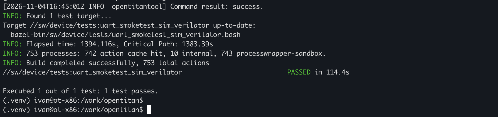

*Рисунок 21 — Успешное выполнение UART smoke test в модели OpenTitan*

Полная сборка на последнем запуске заняла около 23 минут (1394 с), сам тест — 114,4 с.

Результат показывает, что:

* Verilator перевёл RTL всего чипа Earl Grey в C++, и модель `Vchip_sim_tb` скомпилировалась;
* RISC-V toolchain собрал test ROM, образ OTP и программу теста;
* процессор Ibex внутри модели выполнил программу и передал результат через UART.

---

<a id="s15"></a>

## 15. Сохранение файлов модели

Для запуска Zephyr нужны три файла из сборки OpenTitan. Они лежат в кэше Bazel, а ссылка `bazel-bin` при следующих сборках может начать указывать в другое место. Поэтому файлы скопированы в отдельный каталог:

```bash
mkdir -p /work/sim && cp -L bazel-out/k8-opt-exec-*/bin/hw/build.verilator_real/sim-verilator/Vchip_sim_tb bazel-bin/sw/device/lib/testing/test_rom/test_rom_sim_verilator.39.scr.vmem bazel-bin/hw/ip/otp_ctrl/data/img_rma.24.vmem /work/sim/ && ls -lh /work/sim
```

| Файл | Размер | Содержимое |
| --- | --- | --- |
| `Vchip_sim_tb` | 134 МБ | RTL-модель чипа Earl Grey |
| `test_rom_sim_verilator.39.scr.vmem` | 102 КБ | образ test ROM; `scr` означает scrambled: контроллер ROM OpenTitan хранит содержимое в зашифрованном виде |
| `img_rma.24.vmem` | 65 КБ | образ OTP в состоянии жизненного цикла RMA |

Ключ `cp -L` копирует сами файлы, а не символические ссылки на кэш Bazel.

---

<a id="s16"></a>

## 16. Окружение Zephyr

**Zephyr** — операционная система реального времени (RTOS) для микроконтроллеров. В ней есть планировщик потоков, драйверы, сетевой стек и криптографические библиотеки. Zephyr 3.7.0 поддерживает плату `opentitan_earlgrey` и умеет выводить текст через UART OpenTitan.

Python-зависимости Zephyr конфликтуют с зависимостями OpenTitan, поэтому для Zephyr создано отдельное окружение. Сначала установлены дополнительные системные пакеты:

```bash
sudo apt install -y gperf device-tree-compiler ccache libmagic1 wget
```

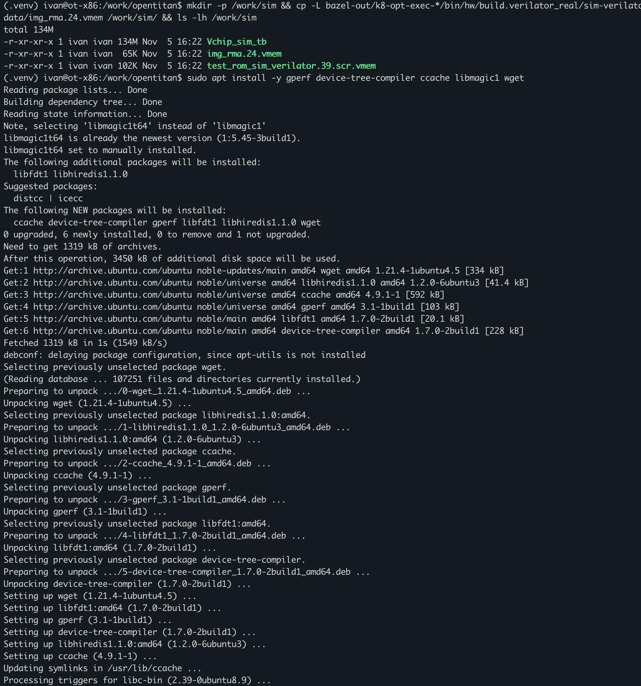

*Рисунок 22 — Копирование файлов модели в /work/sim и установка системных пакетов для Zephyr*

В Ubuntu 24.04 вместо `libmagic1` автоматически выбран пакет `libmagic1t64`.

```bash
deactivate; cd /work && python3 -m venv .venv-zephyr && source .venv-zephyr/bin/activate && pip install -U pip west
```

`deactivate` выключает окружение OpenTitan, которое включается автоматически из `~/.bashrc`.

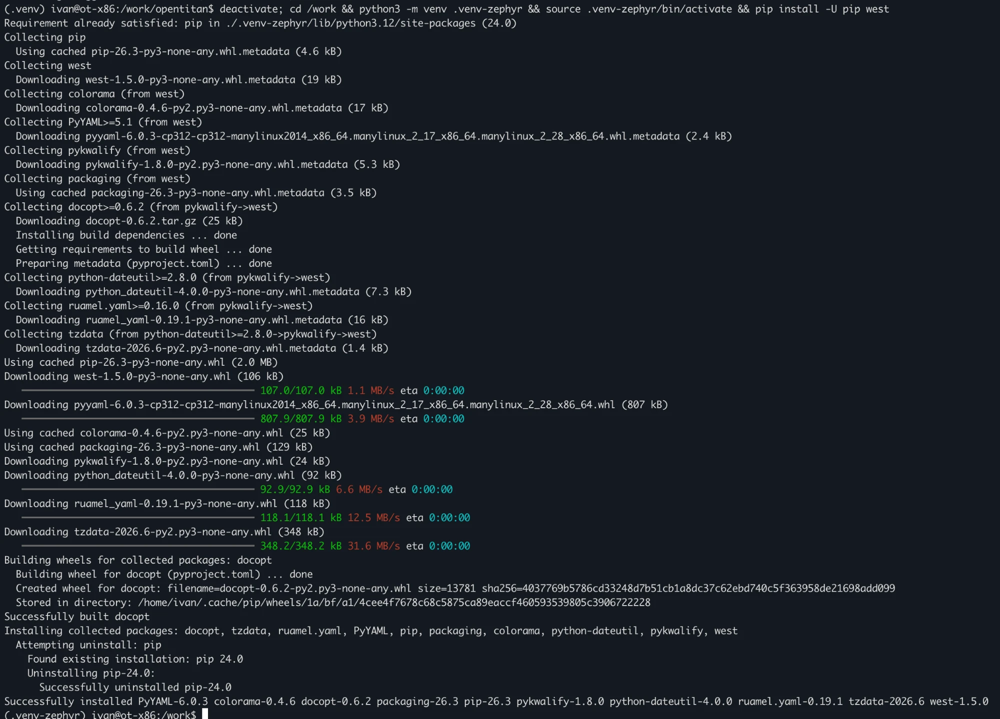

*Рисунок 23 — Создание Python-окружения Zephyr и установка west 1.5.0*

**west** — инструмент проекта Zephyr. Zephyr состоит из десятков git-репозиториев: ядро, HAL производителей, библиотеки вроде mbedTLS. west скачивает их в согласованных версиях, а затем собирает и запускает приложения.

---

<a id="s17"></a>

## 17. Получение Zephyr 3.7.0

```bash
west init -m https://github.com/zephyrproject-rtos/zephyr --mr v3.7.0 zephyrproject && cd zephyrproject
```

`west init` создаёт рабочее пространство `zephyrproject` и скачивает основной репозиторий Zephyr на теге `v3.7.0`.

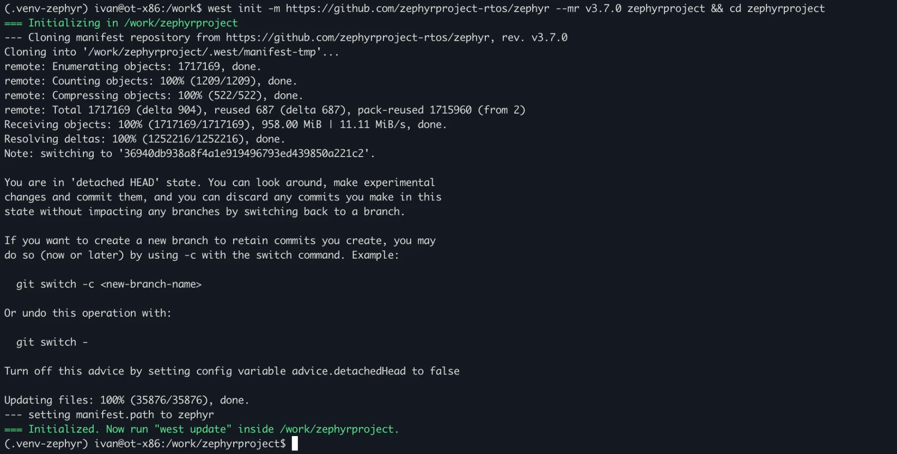

*Рисунок 24 — Инициализация рабочего пространства Zephyr 3.7.0*

```bash
west update --narrow -o=--depth=1
```

`west update` скачивает все модули из манифеста `west.yml`. Ключи `--narrow -o=--depth=1` загружают только нужную версию каждого модуля без истории изменений. Так быстрее и меньше сетевых сбоев.

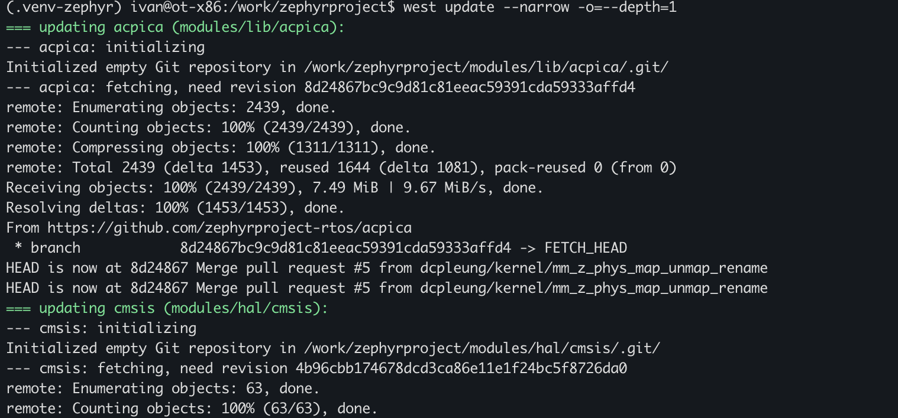

*Рисунок 25 — Загрузка модулей Zephyr командой west update*

Загрузка завершилась без ошибок: все 52 проекта из манифеста на месте, рабочее пространство занимает 4,5 ГБ.

---

<a id="s18"></a>

## 18. Python-зависимости Zephyr

```bash
pip install -r zephyr/scripts/requirements-base.txt
```

`requirements-base.txt` содержит пакеты, необходимые для сборки: CMake-скрипты Zephyr вызывают Python для генерации Device Tree, конфигурации Kconfig и других файлов. Команды `west packages pip --install` в Zephyr 3.7 ещё нет, поэтому зависимости установлены напрямую из файла.

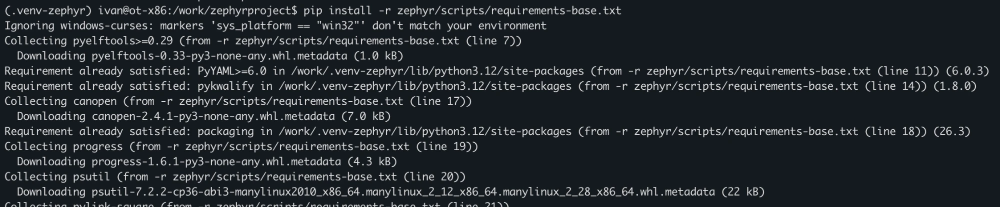

*Рисунок 26 — Установка Python-зависимостей Zephyr из requirements-base.txt*

---

<a id="s19"></a>

## 19. Zephyr SDK 0.16.8

Zephyr SDK содержит собственный компилятор и служебные программы (например, `dtc` — компилятор Device Tree). Zephyr собирается своим компилятором, отдельным от toolchain lowRISC.

```bash
cd ~ && wget https://github.com/zephyrproject-rtos/sdk-ng/releases/download/v0.16.8/zephyr-sdk-0.16.8_linux-x86_64_minimal.tar.xz && tar xf zephyr-sdk-0.16.8_linux-x86_64_minimal.tar.xz && rm zephyr-sdk-0.16.8_linux-x86_64_minimal.tar.xz
cd ~/zephyr-sdk-0.16.8 && ./setup.sh -t riscv64-zephyr-elf -h -c
```

| Параметр | Назначение |
| --- | --- |
| `_minimal` | архив SDK без компиляторов (42 МБ вместо ~1,5 ГБ полного) |
| `-t riscv64-zephyr-elf` | установить только компилятор RISC-V; несмотря на «64» в названии, он собирает и 32-битный код для Ibex |
| `-h` | установить служебные программы хоста |
| `-c` | зарегистрировать SDK в CMake, чтобы `west build` нашёл его автоматически |

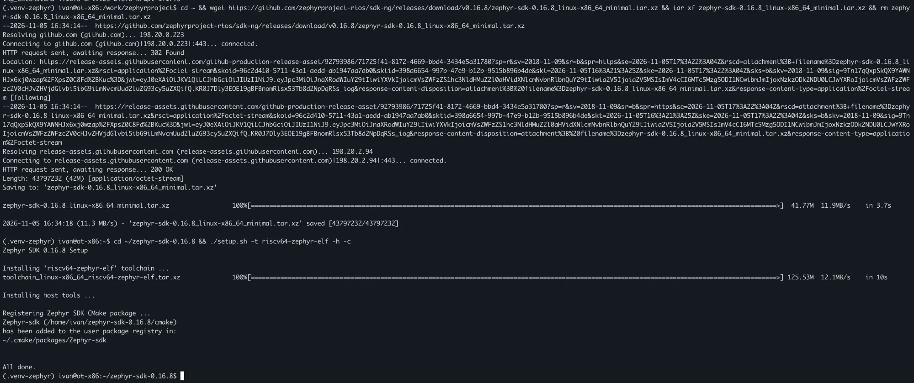

*Рисунок 27 — Загрузка и установка Zephyr SDK 0.16.8 с компилятором RISC-V*

`setup.sh` завершился сообщением `All done.`

---

<a id="s20"></a>

## 20. Сборка Zephyr Hello World

```bash
cd /work/zephyrproject/zephyr && west build -b opentitan_earlgrey samples/hello_world --pristine
```

| Параметр | Назначение |
| --- | --- |
| `west build` | сконфигурировать и собрать приложение |
| `-b opentitan_earlgrey` | целевая плата; Zephyr берёт её описание из `boards/lowrisc/opentitan_earlgrey` |
| `samples/hello_world` | стандартный пример, который печатает приветствие и название платы |
| `--pristine` | собрать с нуля, удалив старый каталог `build` |

Описание платы состоит из двух частей:

* **Device Tree** (`opentitan_earlgrey.dts`) — какая память есть у чипа, по каким адресам расположены устройства (UART, таймер, контроллер прерываний);
* **Kconfig** (`opentitan_earlgrey_defconfig`) — какие подсистемы и драйверы Zephyr включить.

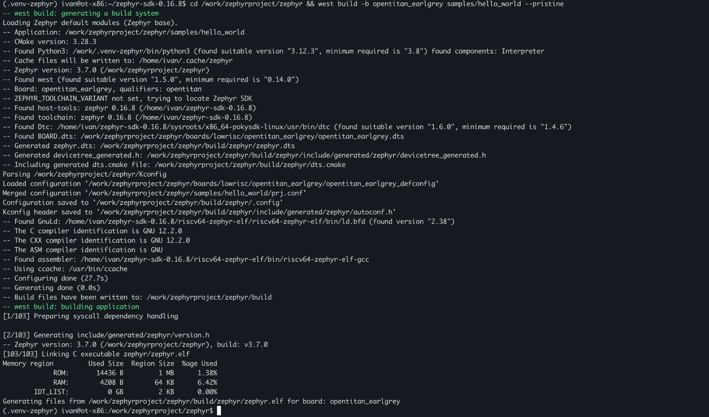

*Рисунок 28 — Конфигурирование и сборка Zephyr Hello World для платы opentitan_earlgrey*

В выводе видно, что CMake нашёл все компоненты:

```text
-- Zephyr version: 3.7.0 (/work/zephyrproject/zephyr)
-- Found west (found suitable version "1.5.0", minimum required is "0.14.0")
-- Board: opentitan_earlgrey, qualifiers: opentitan
-- Found toolchain: zephyr 0.16.8 (/home/ivan/zephyr-sdk-0.16.8)
-- Found BOARD.dts: /work/zephyrproject/zephyr/boards/lowrisc/opentitan_earlgrey/opentitan_earlgrey.dts
-- The C compiler identification is GNU 12.2.0
```

Сборка прошла за 103 шага и завершилась компоновкой `zephyr/zephyr.elf`. Использование памяти:

```text
Memory region         Used Size  Region Size  %age Used
             ROM:       14436 B         1 MB      1.38%
             RAM:        4208 B        64 KB      6.42%
        IDT_LIST:          0 GB         2 KB      0.00%
```

* **ROM** — флеш-память, где хранятся код и константы: 14,1 КБ из 1 МБ.
* **RAM** — оперативная память для переменных, стеков и структур ядра: 4,1 КБ из 64 КБ.
* **IDT_LIST** — служебная область, которая используется только при сборке для формирования таблицы прерываний. В итоговую прошивку она не попадает, поэтому занято 0.

Результат сборки — файл `build/zephyr/zephyr.elf`. ELF — формат исполняемого файла, в нём записан машинный код RISC-V и адреса, по которым его нужно разместить в памяти.

---

<a id="s21"></a>

## 21. Запуск Zephyr в модели OpenTitan

Модель запущена из каталога Zephyr с тремя образами памяти:

```bash
/work/sim/Vchip_sim_tb --verbose-mem-load \
  --meminit=rom,/work/sim/test_rom_sim_verilator.39.scr.vmem \
  --meminit=otp,/work/sim/img_rma.24.vmem \
  --meminit=flash0,build/zephyr/zephyr.elf
```

Параметр `--meminit` загружает содержимое в память чипа до начала моделирования:

| Область | Образ | Назначение |
| --- | --- | --- |
| `rom` | test ROM | код, с которого процессор начинает выполнение после сброса; он инициализирует чип и передаёт управление во флеш |
| `otp` | `img_rma` | однократно программируемая память с настройками чипа; образ задаёт состояние жизненного цикла RMA, в котором отладка открыта |
| `flash0` | `zephyr.elf` | флеш-память, куда загружается Zephyr с приложением |

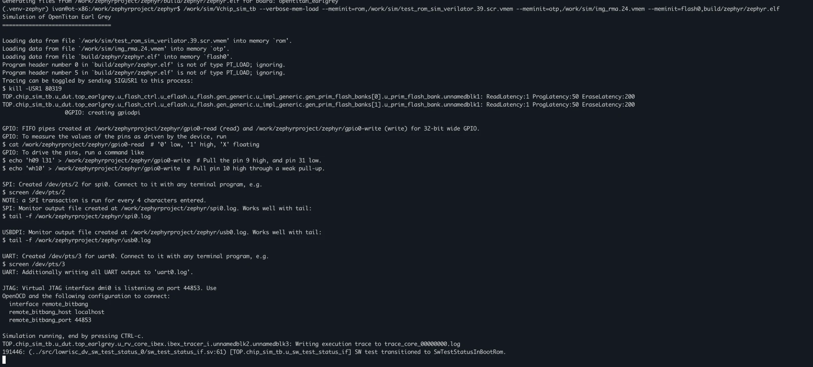

*Рисунок 29 — Загрузка ROM, OTP и Zephyr ELF в модель OpenTitan и запуск моделирования*

Что сообщила модель при запуске:

* `Loading data from file …` — ROM, OTP и флеш загружены;
* `Program header number 0/5 … is not of type PT_LOAD; ignoring` — не ошибка: в ELF-файле есть служебные заголовки, а в память копируются только сегменты типа `PT_LOAD` с кодом и данными;
* флеш-память из двух банков с задержками чтения 1, записи 50 и стирания 200 тактов;
* созданы виртуальные интерфейсы: GPIO через каналы `gpio0-read` и `gpio0-write`, SPI на `/dev/pts/2`, USB с журналом `usb0.log`, **UART на `/dev/pts/3` с копией вывода в `uart0.log`**, JTAG на TCP-порту 44853 для OpenOCD;
* `Writing execution trace to trace_core_00000000.log` — трасса всех инструкций, выполненных ядром Ibex;
* на такте 191 446 — `SW test transitioned to SwTestStatusInBootRom`: процессор начал выполнять test ROM.

Сама модель в терминал вывод программы не печатает. Всё, что программа отправляет в UART, попадает в `/dev/pts/3` и в файл `uart0.log`. Для просмотра во втором терминале выполнена команда:

```bash
docker exec -it -u ivan ot bash -c 'tail -f /work/zephyrproject/zephyr/uart0.log'
```

`tail -f` выводит конец файла и продолжает показывать новые строки по мере их появления. Это аналог подключения к последовательному порту настоящей платы.

---

<a id="s22"></a>

## 22. Результат — Hello World

Вывод UART:

```text
I00001 test_rom.c:158] kBuildInfo: scm_revision=54697461
I00002 test_rom.c:230] Test ROM complete, jumping to flash (addr: 20000404)!
*** Booting Zephyr OS build v3.7.0 ***
Hello World! opentitan_earlgrey/opentitan
```

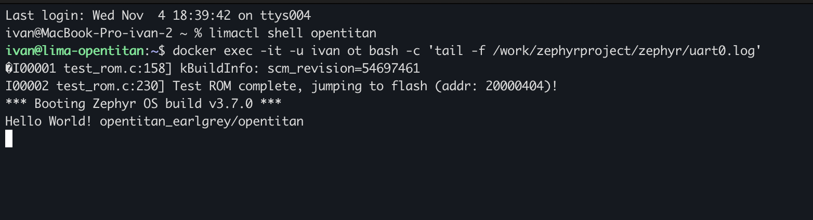

*Рисунок 30 — Загрузка Zephyr RTOS и вывод Hello World в UART модели OpenTitan*

Разбор по строкам:

1. **`kBuildInfo: scm_revision=54697461`** — test ROM сообщает информацию о своей сборке. Значение `0x54697461` в ASCII — строка `Tita`: в сборке без отметки версии вместо хеша коммита стоит заглушка.
2. **`Test ROM complete, jumping to flash (addr: 20000404)!`** — test ROM инициализировал чип и передаёт управление во флеш. Адрес `0x20000404` лежит во флеш-памяти Earl Grey, которая начинается с `0x2000_0000`.
3. **`*** Booting Zephyr OS build v3.7.0 ***`** — управление получил Zephyr, ядро инициализировалось и вывело баннер.
4. **`Hello World! opentitan_earlgrey/opentitan`** — приложение `hello_world` выполнилось и напечатало название платы.

Непечатаемый символ в начале первой строки — байт, попавший в UART в момент его включения; на результат он не влияет.

Тем самым подтверждена вся цепочка: RTL-модель OpenTitan в Verilator → test ROM → флеш → Zephyr RTOS → приложение → UART.

После получения результата модель остановлена через `Ctrl+C`. Файл трассы `trace_core_00000000.log` быстро растёт (сотни мегабайт за несколько минут), поэтому после остановки модели он удалён.

---

<a id="s23"></a>

## 23. Проблемы и решения

| № | Проблема | Причина | Решение |
| :---: | --- | --- | --- |
| 1 | Bazel не собирает OpenTitan на ARM | В `earlgrey_1.0.0` тулчейны RISC-V и Rust объявлены только для x86_64 | Docker-контейнер `linux/amd64` в ВМ, программы выполняются через Rosetta; Python-окружение пересоздано в контейнере |
| 2 | `get-toolchain.py` может скачать архив для aarch64 | Скрипт берёт первый подходящий архив выпуска, а в выпусках lowRISC теперь есть обе архитектуры | Архив `rv32imcb-x86_64-20250710-1` скачан вручную |
| 3 | Пакет `libncursesw5` не найден | В Ubuntu 24.04 нет этой версии пакета | Заменён на `libncursesw6` |
| 4 | `pkgutil has no attribute ImpImporter` | Старый `setuptools` несовместим с Python 3.12 | Заранее установлен `setuptools>=68,<81` (80.10.2) |
| 5 | `libtinfo.so.5` отсутствует | `libclang` из Bazel собрана со старой библиотекой терминала | Заранее установлен `libtinfo5` из Ubuntu 22.04 |
| 6 | Docker: `permission denied` после `usermod` | lima переиспользует SSH-подключение, новая группа не применяется | Перезапуск ВМ |
| 7 | Сбой `configure` у elfutils (libelf) | Случайный сбой при параллельной сборке через Rosetta; вне песочницы и при отдельной сборке шаг проходит | Повторный запуск сборки |
| 8 | `verilator --version` — код 127 | Режим `--incompatible_strict_action_env` оставляет в `PATH` только системные каталоги | Символические ссылки на Verilator в `/usr/local/bin` |

Проблемы 3–5 известны по методическим материалам и опыту других студентов, поэтому были предотвращены заранее. Проблемы 1, 2, 6 связаны с выполнением работы на Apple Silicon. Проблемы 7 и 8 возникли при сборке и были диагностированы по журналам Bazel.

---

<a id="s24"></a>

## 24. Заключение

В ходе работы на компьютере Mac с процессором Apple Silicon подготовлено окружение для программного моделирования аппаратного корня доверия OpenTitan Earl Grey.

Сборочная система OpenTitan `earlgrey_1.0.0` работает только на x86_64. Поэтому стенд построен в три уровня: виртуальная машина lima с Ubuntu 24.04 для ARM, а внутри неё Docker-контейнер x86_64, программы которого выполняются через Rosetta 2.

В контейнере установлены зависимости OpenTitan, RISC-V toolchain lowRISC и собран Verilator 4.210. Bazel собрал RTL-модель чипа `Vchip_sim_tb`, а штатный тест `uart_smoketest` прошёл успешно (`PASSED in 114.4s`). Это подтвердило, что модель работает и процессор Ibex выполняет программы.

Затем установлены Zephyr RTOS 3.7.0 и Zephyr SDK 0.16.8. Приложение `hello_world` собрано для платы `opentitan_earlgrey` (14,1 КБ флеш-памяти и 4,1 КБ ОЗУ). При запуске в модели test ROM передал управление во флеш, загрузился Zephyr, и в UART получен вывод:

```text
*** Booting Zephyr OS build v3.7.0 ***
Hello World! opentitan_earlgrey/opentitan
```

Окружение готово для следующих работ: в них в модели OpenTitan будут запускаться собственные приложения Zephyr, которые взаимодействуют с хостом через UART.

---

[К списку практических работ](../../README.md)
