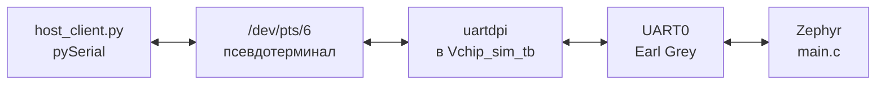
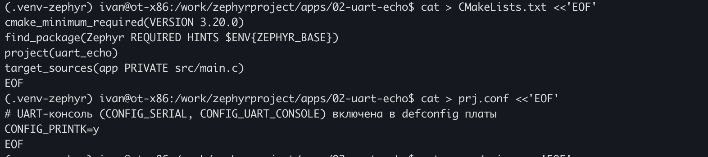
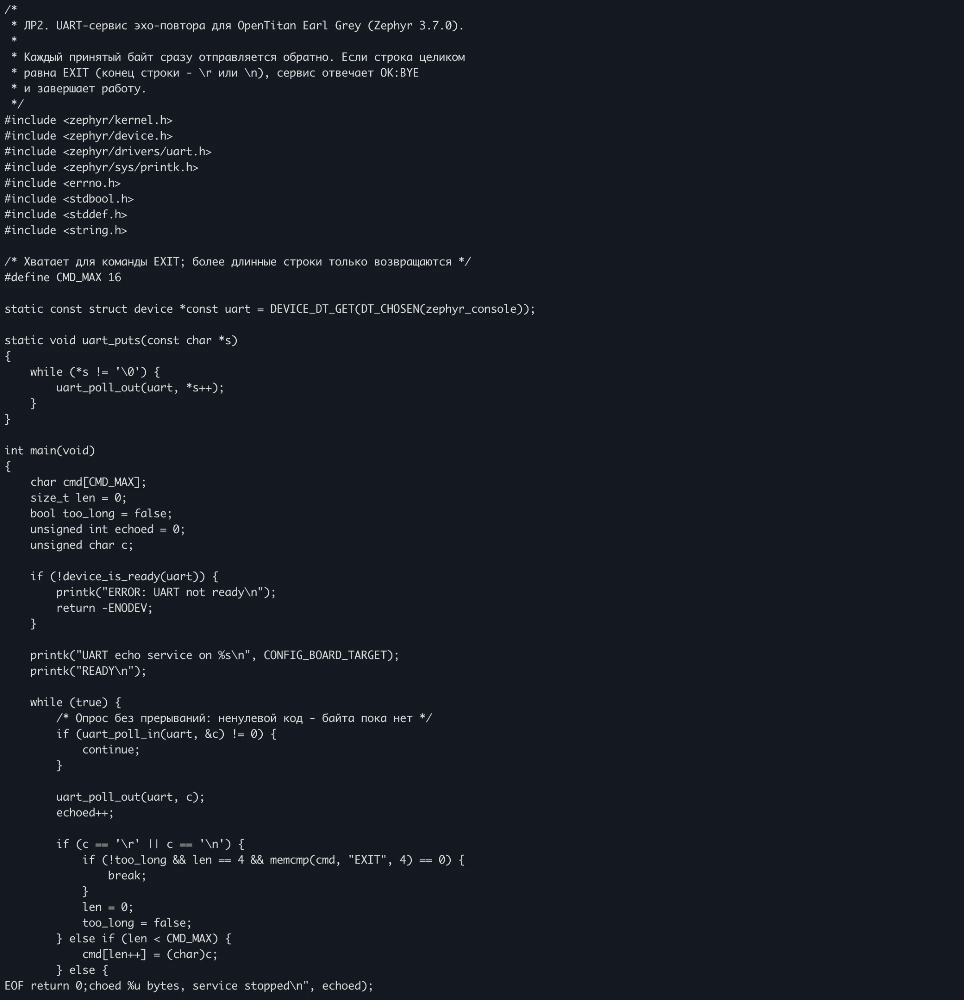
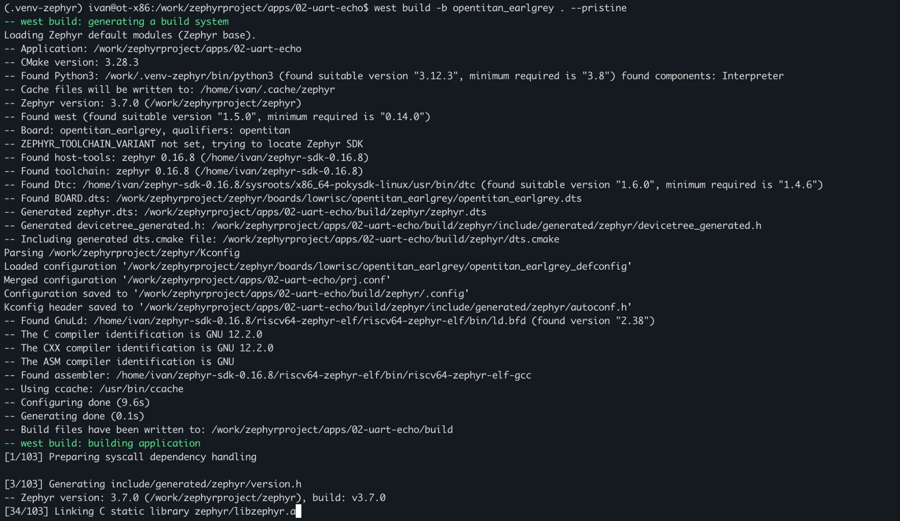
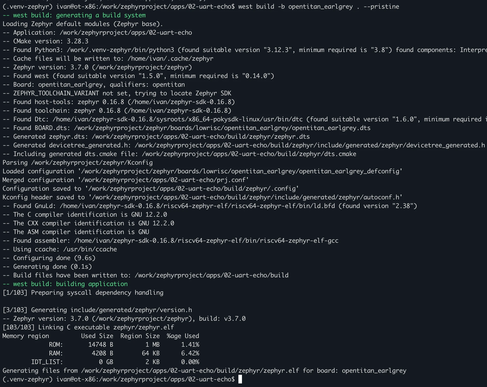
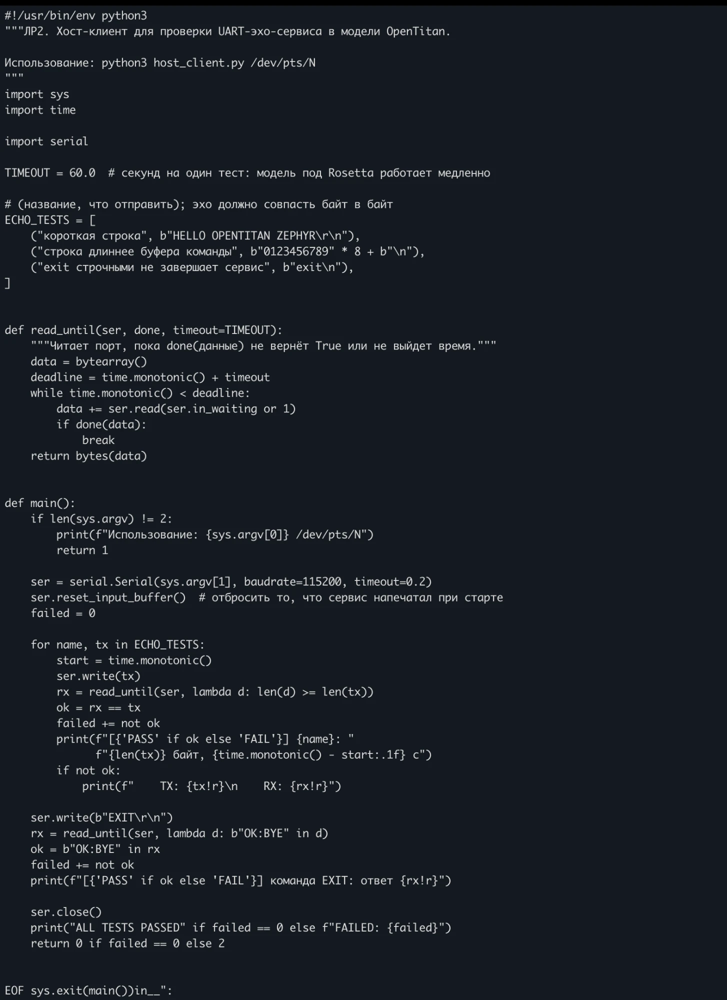
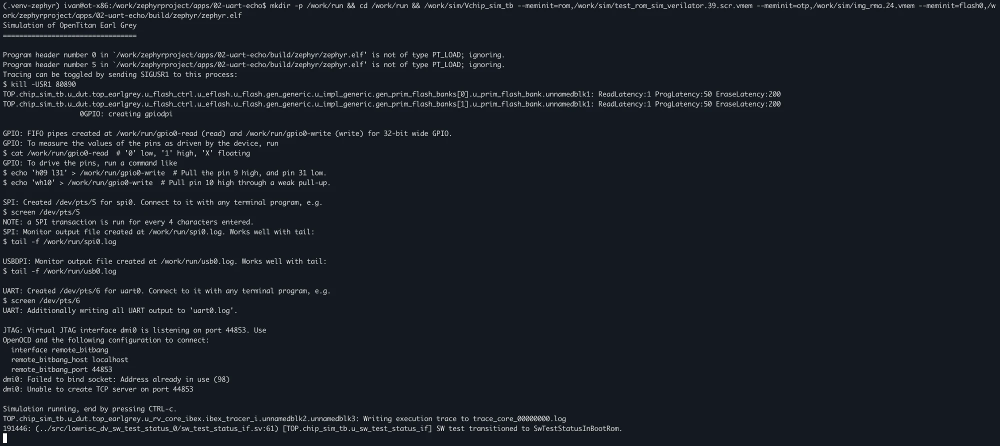
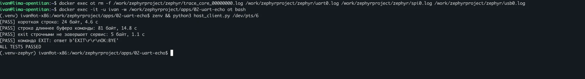
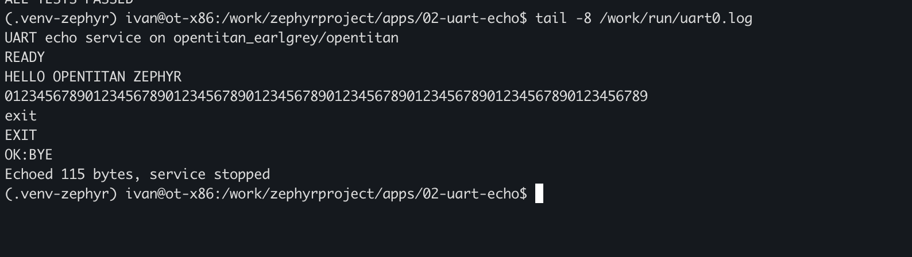

# Практическая работа 2 · UART-сервис эхо-повтора

Сервис на Zephyr RTOS, который возвращает каждый принятый по UART байт, и Python-клиент для его автоматической проверки в RTL-модели OpenTitan Earl Grey.

[К списку практических работ](../../README.md) · [Подготовка окружения](../01-environment/README.md)

## Паспорт работы

| Параметр | Значение |
| --- | --- |
| Исполнители | Груздев И., Гошин А., группа ИУ10-95 |
| Стенд | из [работы 1](../01-environment/README.md): ВМ lima + x86_64-контейнер через Rosetta 2 |
| Zephyr RTOS / SDK | 3.7.0 / 0.16.8 (GCC 12.2.0) |
| Плата | `opentitan_earlgrey` |
| Модель | `Vchip_sim_tb` (OpenTitan `earlgrey_1.0.0`, Verilator 4.210) |
| Клиент | Python 3.12.3, pySerial 3.5 |
| UART в выполненном запуске | `/dev/pts/6` |
| Исходный код | [app/](app/) — `src/main.c`, `prj.conf`, `CMakeLists.txt`, `host_client.py` |
| Результат | 4 из 4 проверок — `ALL TESTS PASSED`; журнал UART — [results/uart0.log](results/uart0.log) |

## Навигация

- [Цель работы](#s01)
- [Путь данных](#s02)
- [Проект приложения](#s03)
- [Реализация сервиса](#s04)
- [Сборка](#s05)
- [Хост-клиент](#s06)
- [Запуск модели](#s07)
- [Результаты](#s08)
- [Проблемы и решения](#s09)
- [Ограничения проверки](#s10)
- [Повторный запуск](#s11)
- [Заключение](#s12)

<a id="s01"></a>

## 1. Цель работы

Разработать для Zephyr RTOS сервис, который принимает байты по UART и сразу возвращает их отправителю, и проверить его работу в модели OpenTitan с хоста.

Требования к сервису:

1. Получать UART из описания платы (Device Tree), а не по жёстко заданному адресу.
2. Проверять готовность устройства перед работой.
3. Возвращать каждый принятый байт без изменений.
4. Завершать работу по команде `EXIT`, переданной отдельной строкой, и подтверждать её ответом `OK:BYE`.

Требования к клиенту: подключиться к UART модели, отправить тестовые данные, сравнить ответ с отправленным и проверить команду завершения.

---

<a id="s02"></a>

## 2. Путь данных



* Модель OpenTitan при запуске создаёт **псевдотерминал** (PTY) `/dev/pts/N`. Для программ на хосте он выглядит как обычный последовательный порт.
* Байты, записанные в PTY, модуль `uartdpi` модели побитно подаёт на вход RX блока UART0 чипа. Всё, что чип передаёт по TX, возвращается в PTY и дублируется в файл `uart0.log`.
* Скорость обмена задаёт модель, а не настройки порта: параметр `baudrate=115200` в клиенте для псевдотерминала ни на что не влияет.

---

<a id="s03"></a>

## 3. Проект приложения

Приложение размещено в рабочем пространстве west, но отдельно от исходников Zephyr — так это *workspace application*:

```text
/work/zephyrproject/
├── zephyr/                  # Zephyr 3.7.0
└── apps/02-uart-echo/
    ├── CMakeLists.txt
    ├── prj.conf
    ├── src/main.c           # сервис
    └── host_client.py       # клиент
```

Для удобства в `~/.bashrc` контейнера добавлено сокращение, которое включает окружение Zephyr и задаёт `ZEPHYR_BASE`:

```bash
alias zenv='deactivate 2>/dev/null; source /work/.venv-zephyr/bin/activate; export ZEPHYR_BASE=/work/zephyrproject/zephyr'
```

`CMakeLists.txt` подключает систему сборки Zephyr и добавляет исходный файл приложения в цель `app`:

```cmake
cmake_minimum_required(VERSION 3.20.0)
find_package(Zephyr REQUIRED HINTS $ENV{ZEPHYR_BASE})
project(uart_echo)
target_sources(app PRIVATE src/main.c)
```

`prj.conf` — конфигурация Kconfig приложения. UART-консоль уже включена в `opentitan_earlgrey_defconfig` (`CONFIG_SERIAL`, `CONFIG_CONSOLE`, `CONFIG_UART_CONSOLE`), поэтому явно задан только `printk`:

```ini
# UART-консоль (CONFIG_SERIAL, CONFIG_UART_CONSOLE) включена в defconfig платы
CONFIG_PRINTK=y
```



*Рисунок 1 — Создание файлов CMakeLists.txt и prj.conf*

---

<a id="s04"></a>

## 4. Реализация сервиса

Исходный код [src/main.c](app/src/main.c):

```c
/*
 * ЛР2. UART-сервис эхо-повтора для OpenTitan Earl Grey (Zephyr 3.7.0).
 *
 * Каждый принятый байт сразу отправляется обратно. Если строка целиком
 * равна EXIT (конец строки - \r или \n), сервис отвечает OK:BYE
 * и завершает работу.
 */
#include <zephyr/kernel.h>
#include <zephyr/device.h>
#include <zephyr/drivers/uart.h>
#include <zephyr/sys/printk.h>
#include <errno.h>
#include <stdbool.h>
#include <stddef.h>
#include <string.h>

/* Хватает для команды EXIT; более длинные строки только возвращаются */
#define CMD_MAX 16

static const struct device *const uart = DEVICE_DT_GET(DT_CHOSEN(zephyr_console));

static void uart_puts(const char *s)
{
    while (*s != '\0') {
        uart_poll_out(uart, *s++);
    }
}

int main(void)
{
    char cmd[CMD_MAX];
    size_t len = 0;
    bool too_long = false;
    unsigned int echoed = 0;
    unsigned char c;

    if (!device_is_ready(uart)) {
        printk("ERROR: UART not ready\n");
        return -ENODEV;
    }

    printk("UART echo service on %s\n", CONFIG_BOARD_TARGET);
    printk("READY\n");

    while (true) {
        /* Опрос без прерываний: ненулевой код - байта пока нет */
        if (uart_poll_in(uart, &c) != 0) {
            continue;
        }

        uart_poll_out(uart, c);
        echoed++;

        if (c == '\r' || c == '\n') {
            if (!too_long && len == 4 && memcmp(cmd, "EXIT", 4) == 0) {
                break;
            }
            len = 0;
            too_long = false;
        } else if (len < CMD_MAX) {
            cmd[len++] = (char)c;
        } else {
            too_long = true;
        }
    }

    uart_puts("\r\nOK:BYE\r\n");
    printk("Echoed %u bytes, service stopped\n", echoed);
    return 0;
}
```



*Рисунок 2 — Создание файла src/main.c*

В последних строках рисунка 2 текст наложился: так терминал отрисовал длинную вставку. Целостность файла проверена отдельно: 70 строк, конец файла на месте, и сборка из него прошла.

### 4.1. Выбор UART

```c
static const struct device *const uart = DEVICE_DT_GET(DT_CHOSEN(zephyr_console));
```

В Device Tree платы `opentitan_earlgrey.dts` есть узел `chosen` со свойством `zephyr,console = &uart0`. Макрос `DT_CHOSEN(zephyr_console)` находит этот узел ещё при компиляции, а `DEVICE_DT_GET` даёт указатель на его драйвер. Адрес регистров UART в коде не фигурирует: при переносе на другую плату достаточно её описания.

`device_is_ready()` проверяет, что драйвер успешно инициализировался при загрузке ядра. Если нет, сервис сообщает об ошибке и завершается с кодом `-ENODEV`.

### 4.2. Цикл эхо-повтора

* `uart_poll_in(uart, &c)` возвращает `0`, если в приёмном FIFO UART есть байт, и `-1`, если нет. Сервис опрашивает UART в цикле (**polling**) без прерываний: в приложении один поток, и такой подход проще всего.
* Принятый байт сразу отправляется обратно через `uart_poll_out()`, которая ждёт свободного места в передающем FIFO. Эхо не зависит от разбора команд.
* Счётчик `echoed` считает возвращённые байты. При завершении он выводится в журнал, чтобы сверить его с объёмом отправленных клиентом данных.

### 4.3. Распознавание EXIT

Параллельно байты складываются в буфер `cmd` на 16 байт, только чтобы узнать команду:

* символ `\r` или `\n` — конец строки: если в буфере ровно `EXIT` и строка не была длиннее буфера, цикл завершается; иначе буфер сбрасывается;
* при переполнении строка помечается `too_long` и командой считаться не может; эхо при этом продолжается;
* последовательность `\r\n` даёт после `\r` пустую строку, которая просто сбрасывает буфер ещё раз, — отдельной обработки не нужно;
* сравнение регистрозависимое: `exit` командой не является.

После `EXIT` сервис отправляет `\r\nOK:BYE\r\n`, печатает число возвращённых байтов и выходит из `main()`. Это завершает только поток приложения, ядро Zephyr и модель продолжают работать.

Строки `printk` в журнале заканчиваются на `\r\n`, хотя в коде написано `\n`: драйвер UART-консоли Zephyr сам добавляет `\r` перед каждым `\n`.

---

<a id="s05"></a>

## 5. Сборка

```bash
zenv
cd /work/zephyrproject/apps/02-uart-echo
west build -b opentitan_earlgrey . --pristine
```

Точка — путь к приложению (текущий каталог). Каталог сборки `build/` создаётся рядом с исходниками.



*Рисунок 3 — Конфигурирование: приложение apps/02-uart-echo, плата opentitan_earlgrey, SDK 0.16.8*



*Рисунок 4 — Завершение сборки и использование памяти*

| Область | Hello World (работа 1) | Эхо-сервис | Разница |
| --- | ---: | ---: | ---: |
| ROM (флеш) | 14 436 Б | 14 748 Б (1,41 % из 1 МБ) | +312 Б |
| RAM | 4 208 Б | 4 208 Б (6,42 % из 64 КБ) | 0 |

Код вырос на 312 байт: добавились функции приёма драйвера UART и цикл сервиса. Статическая RAM не изменилась, потому что буфер команды и переменные лежат в стеке потока `main`, а он выделен заранее и входит в те же 4 208 байт.

---

<a id="s06"></a>

## 6. Хост-клиент

Исходный код [host_client.py](app/host_client.py):

```python
#!/usr/bin/env python3
"""ЛР2. Хост-клиент для проверки UART-эхо-сервиса в модели OpenTitan.

Использование: python3 host_client.py /dev/pts/N
"""
import sys
import time

import serial

TIMEOUT = 60.0  # секунд на один тест: модель под Rosetta работает медленно

# (название, что отправить); эхо должно совпасть байт в байт
ECHO_TESTS = [
    ("короткая строка", b"HELLO OPENTITAN ZEPHYR\r\n"),
    ("строка длиннее буфера команды", b"0123456789" * 8 + b"\n"),
    ("exit строчными не завершает сервис", b"exit\n"),
]


def read_until(ser, done, timeout=TIMEOUT):
    """Читает порт, пока done(данные) не вернёт True или не выйдет время."""
    data = bytearray()
    deadline = time.monotonic() + timeout
    while time.monotonic() < deadline:
        data += ser.read(ser.in_waiting or 1)
        if done(data):
            break
    return bytes(data)


def main():
    if len(sys.argv) != 2:
        print(f"Использование: {sys.argv[0]} /dev/pts/N")
        return 1

    ser = serial.Serial(sys.argv[1], baudrate=115200, timeout=0.2)
    ser.reset_input_buffer()  # отбросить то, что сервис напечатал при старте
    failed = 0

    for name, tx in ECHO_TESTS:
        start = time.monotonic()
        ser.write(tx)
        rx = read_until(ser, lambda d: len(d) >= len(tx))
        ok = rx == tx
        failed += not ok
        print(f"[{'PASS' if ok else 'FAIL'}] {name}: "
              f"{len(tx)} байт, {time.monotonic() - start:.1f} с")
        if not ok:
            print(f"    TX: {tx!r}\n    RX: {rx!r}")

    ser.write(b"EXIT\r\n")
    rx = read_until(ser, lambda d: b"OK:BYE" in d)
    ok = b"OK:BYE" in rx
    failed += not ok
    print(f"[{'PASS' if ok else 'FAIL'}] команда EXIT: ответ {rx!r}")

    ser.close()
    print("ALL TESTS PASSED" if failed == 0 else f"FAILED: {failed}")
    return 0 if failed == 0 else 2


if __name__ == "__main__":
    sys.exit(main())
```



*Рисунок 5 — Создание клиента host_client.py (наложение в последних строках — артефакт отрисовки терминала; файл проверен `python3 -m py_compile`)*

Как устроен клиент:

* `ser.reset_input_buffer()` выбрасывает приветствие сервиса, которое накопилось в порту до подключения клиента, чтобы оно не смешалось с эхом.
* `read_until()` читает порт порциями, пока не выполнится условие или не пройдёт 60 секунд. Ответ модели приходит медленно и по частям, поэтому одного вызова `read()` недостаточно.
* Каждая проверка эха сравнивает ответ с отправленными данными **байт в байт** и выводит затраченное время.

| № | Проверка | Отправлено | Ожидается |
| :---: | --- | --- | --- |
| 1 | Короткая строка | `HELLO OPENTITAN ZEPHYR\r\n`, 24 байта | тот же 24-байтный ответ |
| 2 | Строка длиннее буфера команды | 80 цифр + `\n`, 81 байт | тот же ответ: эхо работает и при переполнении буфера |
| 3 | `exit` строчными | `exit\n`, 5 байт | эхо, сервис продолжает работу |
| 4 | Команда завершения | `EXIT\r\n` | ответ содержит `OK:BYE` |

---

<a id="s07"></a>

## 7. Запуск модели

Модель запускается из отдельного каталога `/work/run`: в текущий каталог она пишет журналы и трассу процессора, и так они не смешиваются с исходниками.

```bash
mkdir -p /work/run && cd /work/run && /work/sim/Vchip_sim_tb \
  --meminit=rom,/work/sim/test_rom_sim_verilator.39.scr.vmem \
  --meminit=otp,/work/sim/img_rma.24.vmem \
  --meminit=flash0,/work/zephyrproject/apps/02-uart-echo/build/zephyr/zephyr.elf
```



*Рисунок 6 — Запуск модели: UART на /dev/pts/6, ошибка привязки JTAG-порта 44853*

Модель создала UART на `/dev/pts/6`. Строки `dmi0: Failed to bind socket: Address already in use` разобраны в [разделе 9](#s09).

Готовность сервиса проверялась по журналу во втором терминале (`tail -f /work/run/uart0.log`): после загрузки Zephyr появились строки `UART echo service on opentitan_earlgrey/opentitan` и `READY`. Затем клиент был запущен в том же контейнере:

```bash
zenv && python3 host_client.py /dev/pts/6
```

---

<a id="s08"></a>

## 8. Результаты



*Рисунок 7 — Все проверки клиента пройдены*

```text
[PASS] короткая строка: 24 байт, 4.6 с
[PASS] строка длиннее буфера команды: 81 байт, 14.8 с
[PASS] exit строчными не завершает сервис: 5 байт, 1.1 с
[PASS] команда EXIT: ответ b'EXIT\r\r\nOK:BYE'
ALL TESTS PASSED
```

Ответ на команду завершения состоит из эха `EXIT\r` и подтверждения `\r\nOK:BYE`. Символ `\n` из `EXIT\r\n` сервис уже не читает: цикл завершается на `\r`.

Журнал UART после проверок ([results/uart0.log](results/uart0.log)):



*Рисунок 8 — Журнал uart0.log: эхо всех строк, OK:BYE и итог сервиса*

```text
UART echo service on opentitan_earlgrey/opentitan
READY
HELLO OPENTITAN ZEPHYR
01234567890123456789012345678901234567890123456789012345678901234567890123456789
exit
EXIT
OK:BYE
Echoed 115 bytes, service stopped
```

Сверка счётчика: клиент отправил 24 + 81 + 5 + 6 = 116 байт, сервис прочитал и вернул 24 + 81 + 5 + 5 = **115** (последний `\n` после `EXIT\r` остался непрочитанным). Значение в журнале совпадает с расчётом — ни один байт не потерян и не продублирован.

**Скорость.** Эхо шло со скоростью около 5,5 байта в секунду в обе стороны (81 байт за 14,8 с). Это скорость моделирования: модель выполняет чип потактово, к тому же через Rosetta. Настоящий UART на 115 200 бод передал бы те же 81 байт примерно за 7 мс.

| Проверка | Результат | Вывод |
| --- | --- | --- |
| Сборка для `opentitan_earlgrey` | `zephyr.elf`, ROM 14 748 Б | сборка успешна |
| Готовность UART | `READY` в журнале | драйвер инициализирован |
| Эхо короткой строки с CRLF | TX = RX, 24 байта | данные возвращаются без изменений |
| Эхо строки длиннее буфера | TX = RX, 81 байт | переполнение буфера команды не мешает эху |
| `exit` строчными | эхо, сервис работает | команда регистрозависимая |
| `EXIT` | `OK:BYE`, `service stopped` | команда распознана, сервис завершён |
| Счётчик байтов | 115 = расчёт | потерь нет |

---

<a id="s09"></a>

## 9. Проблемы и решения

| Проблема | Причина | Решение |
| --- | --- | --- |
| `dmi0: Failed to bind socket: Address already in use (98)` при запуске модели | Модель Hello World из работы 1 не была остановлена: вкладку терминала закрыли без Ctrl+C, а процесс в контейнере продолжил работать. Он 4 ч 46 мин занимал TCP-порт JTAG 44853 и около 4 ядер процессора из 8 | Старый процесс завершён (`docker exec ot kill <PID>` из ВМ), его журналы удалены. Для эхо-сервиса JTAG не нужен, но без второго процесса модель получила весь процессор |
| Наложение строк в конце длинных вставок (рисунки 2 и 5) | Особенность отрисовки терминала при вставке многострочного текста через heredoc | Целостность файлов проверена в контейнере: `wc -l`, `tail`, `python3 -m py_compile`; сборка и запуск прошли |

Вывод из первой проблемы: модель нужно останавливать через Ctrl+C в её терминале. Закрытие вкладки не завершает процесс внутри контейнера.

---

<a id="s10"></a>

## 10. Ограничения проверки

* Проверены печатные символы ASCII и концы строк `\r`, `\n`. Произвольные байты (`0x00`–`0x1F`, `0x80`–`0xFF`) не отправлялись.
* Всего передано 116 байт за один запуск. Длительный поток и потери при высокой нагрузке не проверялись.
* Опрос UART в бесконечном цикле занимает процессор полностью. В реальном устройстве лучше использовать прерывания или асинхронный API UART Zephyr, чтобы процессор мог спать или выполнять другие задачи.
* После `EXIT` сервис завершён; для нового прогона клиента модель нужно перезапустить.

---

<a id="s11"></a>

## 11. Повторный запуск

1. Войти в контейнер и включить окружение Zephyr: `zenv`.
2. Собрать приложение (раздел 5).
3. Запустить модель из `/work/run` (раздел 7) и запомнить номер PTY из строки `UART: Created /dev/pts/N for uart0`.
4. Во втором терминале дождаться `READY` в `/work/run/uart0.log`.
5. Запустить `python3 host_client.py /dev/pts/N`.
6. Остановить модель через Ctrl+C и удалить трассу `/work/run/trace_core_00000000.log`: она растёт примерно на 4 МБ в минуту.

---

<a id="s12"></a>

## 12. Заключение

Разработан UART-сервис эхо-повтора для Zephyr RTOS 3.7.0 на плате `opentitan_earlgrey` и Python-клиент для его автоматической проверки.

Сервис получает UART из Device Tree, проверяет его готовность, возвращает каждый принятый байт и завершает работу по команде `EXIT`. Сборка заняла 14 748 байт флеш-памяти — на 312 байт больше, чем Hello World.

В модели OpenTitan клиент через псевдотерминал `/dev/pts/6` выполнил четыре проверки: короткую строку, строку длиннее буфера команды, `exit` строчными и команду завершения. Все проверки пройдены, а счётчик сервиса (115 байт) совпал с расчётом, то есть данные передаются без потерь и искажений.

Работа подтверждает двусторонний обмен между хостом и программой внутри модели OpenTitan: на этом механизме строятся сервисы следующих работ.

---

[К списку практических работ](../../README.md)
