# Практическая работа 3 · UART-сервис генерации ключевого материала

Сервис на Zephyr RTOS выдаёт по команде 32 случайных байта через PSA Crypto. Источник энтропии — аппаратный генератор CSRNG чипа OpenTitan Earl Grey, подключённый собственным драйвером.

[К списку практических работ](../../README.md) · [Подготовка окружения](../01-environment/README.md) · [UART-эхо](../02-uart-echo/README.md)

## Паспорт работы

| Параметр | Значение |
| --- | --- |
| Исполнители | Груздев И., Гошин А., группа ИУ10-95 |
| Стенд | из [работы 1](../01-environment/README.md): ВМ lima + x86_64-контейнер через Rosetta 2 |
| Zephyr RTOS / SDK | 3.7.0 / 0.16.8 |
| Криптография | PSA Crypto API, реализация Mbed TLS (модуль Zephyr) |
| Источник энтропии | CSRNG + entropy_src OpenTitan, драйвер из приложения ([src/entropy_ot_csrng.c](app/src/entropy_ot_csrng.c)) |
| Модель | `Vchip_sim_tb` (OpenTitan `earlgrey_1.0.0`, Verilator 4.210), запуск с `+rng_srate_value=5` |
| Клиент | Python 3.12.3, pySerial 3.5 |
| Исходный код | [app/](app/) — сервис, драйвер, Device Tree, Kconfig, клиент |
| Результат | `psa_crypto_init: 0`; 8 из 8 проверок клиента — `ALL TESTS PASSED`; журнал — [results/uart0.log](results/uart0.log) |

## Навигация

- [Цель и протокол](#s01)
- [Почему PSA сообщает о нехватке энтропии](#s02)
- [Этап 1: сервис на PSA](#s03)
- [Этап 2: драйвер CSRNG](#s04)
- [Хост-клиент](#s05)
- [Результаты](#s06)
- [Размер прошивки](#s07)
- [Проблемы и решения](#s08)
- [Ограничения и безопасность](#s09)
- [Повторный запуск](#s10)
- [Заключение](#s11)
- [Источники](#s12)

<a id="s01"></a>

## 1. Цель и протокол

Цель — разработать для Zephyr RTOS сервис, который по команде через UART выдаёт 32 байта (256 бит, размер ключа AES-256) криптографически стойких случайных данных, полученных через PSA Crypto API, и проверить его клиентом с хоста.

| Команда | Ответ | Назначение |
| --- | --- | --- |
| `STATUS` | `OK:READY psa=<код>` | готовность и результат `psa_crypto_init()` |
| `GENKEY` | `KEY:<64 hex-символа>` | 32 байта из `psa_generate_random()` |
| `GENKEY` без энтропии | `ERR:NO_ENTROPY psa=<код>` | отказ вместо небезопасной замены |
| `EXIT` | `OK:BYE` | завершение сервиса |
| неизвестная команда | `ERR:UNKNOWN_CMD` | |
| строка длиннее 31 символа | `ERR:TOO_LONG` | |

Команды передаются по одной в строке, конец строки — `\r` или `\n`. Сервис не повторяет принятые символы (эха нет), каждая строка ответа заканчивается на `\r\n`.

**PSA Crypto** — стандартный криптографический интерфейс Arm Platform Security Architecture. Приложение вызывает функции `psa_*`, а реализацию выбирает сборка. В Zephyr 3.7 реализацию даёт библиотека Mbed TLS. Параметра `CONFIG_PSA_CRYPTO`, который встречается в описаниях задания, в Zephyr 3.7 нет: PSA включается через `CONFIG_MBEDTLS_PSA_CRYPTO_C`.

---

<a id="s02"></a>

## 2. Почему PSA сообщает о нехватке энтропии

Известно, что в модели OpenTitan `psa_crypto_init()` возвращает `-148` — `PSA_ERROR_INSUFFICIENT_ENTROPY`. Типичный обходной путь — тестовый генератор Zephyr (`CONFIG_TEST_RANDOM_GENERATOR`), но он не криптостойкий, и сам Zephyr предупреждает об этом при сборке. Перед написанием кода мы разобрали причину по исходникам Zephyr и OpenTitan в нашем контейнере.

**Чего не хватает в Zephyr 3.7:**

* в `drivers/entropy` нет драйвера для OpenTitan;
* в описании платы `opentitan_earlgrey.dtsi` нет узлов генератора, а в `chosen` нет `zephyr,entropy`;
* поэтому символ `ENTROPY_HAS_DRIVER` не включается, и у Mbed TLS нет ни одного сильного источника энтропии → `-148`.

**Что есть в чипе.** В Earl Grey есть комплекс энтропии:

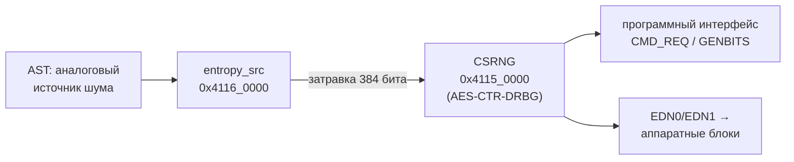

* `entropy_src` собирает шум, проверяет его тестами здоровья и обрабатывает (кондиционирует) аппаратным SHA-3;
* `CSRNG` — детерминированный генератор по NIST SP 800-90A (CTR-DRBG на AES), который берёт затравку у `entropy_src` и выдаёт случайные данные программе через регистры.

Дополнительно проверено:

* тесты OpenTitan `csrng_smoketest` и `entropy_src_smoketest` объявлены для `sim_verilator` — блоки работают в модели;
* после сброса оба блока выключены (`CSRNG CTRL` = `0x9999`, `entropy_src MODULE_ENABLE` = `0x9`), test ROM их не включает;
* в образе OTP `img_rma` установлен `HW_CFG1.EN_CSRNG_SW_APP_READ = True`, то есть программе разрешено читать CSRNG.

**План:** этап 1 — сервис на PSA без источника энтропии, чтобы воспроизвести `-148`; этап 2 — собственный драйвер CSRNG, через который PSA получит аппаратную энтропию.

---

<a id="s03"></a>

## 3. Этап 1: сервис на PSA

Приложение лежит в `/work/zephyrproject/apps/03-keygen` (как и в работе 2 — внутри рабочего пространства west). Конфигурация этапа 1:

```ini
# UART-консоль включена в defconfig платы
CONFIG_PRINTK=y

# PSA Crypto API, реализация из Mbed TLS
CONFIG_MBEDTLS=y
CONFIG_MBEDTLS_PSA_CRYPTO_C=y

# psa_crypto_init() вызываем сами, чтобы увидеть код результата
CONFIG_MBEDTLS_INIT=n
```

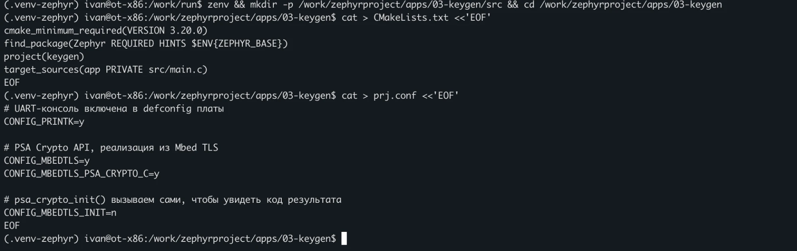

*Рисунок 1 — CMakeLists.txt и prj.conf этапа 1*

Исходный код сервиса [src/main.c](app/src/main.c) (одинаков для обоих этапов):

```c
/*
 * ЛР3. UART-сервис генерации ключевого материала (Zephyr 3.7.0, OpenTitan Earl Grey).
 *
 * Команды (по одной в строке, конец строки - \r или \n):
 *   STATUS - состояние сервиса и результат psa_crypto_init()
 *   GENKEY - 32 случайных байта (256 бит) из psa_generate_random() в HEX
 *   EXIT   - завершение сервиса
 * Без рабочего источника энтропии GENKEY отвечает ошибкой: запасного
 * некриптографического генератора в сервисе нет.
 */
#include <zephyr/kernel.h>
#include <zephyr/device.h>
#include <zephyr/drivers/uart.h>
#include <zephyr/sys/printk.h>
#include <zephyr/sys/util.h>
#include <psa/crypto.h>
#include <mbedtls/platform_util.h>
#include <errno.h>
#include <stdbool.h>
#include <stdio.h>
#include <string.h>

#define LINE_MAX_LEN 32
#define KEY_BYTES 32

static const struct device *const uart = DEVICE_DT_GET(DT_CHOSEN(zephyr_console));
static psa_status_t psa_init_status;

static void reply(const char *s)
{
    while (*s != '\0') {
        uart_poll_out(uart, *s++);
    }
    uart_poll_out(uart, '\r');
    uart_poll_out(uart, '\n');
}

/* Читает строку до \r или \n. Возвращает длину или -1, если строка не влезла */
static int read_line(char *buf, size_t size)
{
    size_t len = 0;
    bool too_long = false;
    unsigned char c;

    while (true) {
        if (uart_poll_in(uart, &c) != 0) {
            continue;
        }
        if (c == '\r' || c == '\n') {
            break;
        }
        if (len < size - 1) {
            buf[len++] = (char)c;
        } else {
            too_long = true;
        }
    }
    buf[len] = '\0';
    return too_long ? -1 : (int)len;
}

static void cmd_genkey(void)
{
    uint8_t key[KEY_BYTES];
    char hex[2 * KEY_BYTES + 1];
    char out[sizeof("KEY:") + sizeof(hex)];
    psa_status_t st;

    if (psa_init_status != PSA_SUCCESS) {
        snprintf(out, sizeof(out), "ERR:NO_ENTROPY psa=%d", (int)psa_init_status);
        reply(out);
        return;
    }

    st = psa_generate_random(key, sizeof(key));
    if (st != PSA_SUCCESS) {
        snprintf(out, sizeof(out), "ERR:KEYGEN psa=%d", (int)st);
        reply(out);
        return;
    }

    bin2hex(key, sizeof(key), hex, sizeof(hex));
    snprintf(out, sizeof(out), "KEY:%s", hex);
    reply(out);

    /* Затираем ключ так, чтобы компилятор не выбросил обнуление */
    mbedtls_platform_zeroize(key, sizeof(key));
    mbedtls_platform_zeroize(hex, sizeof(hex));
    mbedtls_platform_zeroize(out, sizeof(out));
}

int main(void)
{
    char line[LINE_MAX_LEN];
    char out[48];
    int len;

    if (!device_is_ready(uart)) {
        printk("ERROR: UART not ready\n");
        return -ENODEV;
    }

    psa_init_status = psa_crypto_init();

    printk("Key generation service on %s\n", CONFIG_BOARD_TARGET);
    printk("psa_crypto_init: %d\n", (int)psa_init_status);
    printk("READY\n");

    while (true) {
        len = read_line(line, sizeof(line));
        if (len == 0) {
            continue; /* пустая строка, например \n после \r */
        }

        if (len < 0) {
            reply("ERR:TOO_LONG");
        } else if (strcmp(line, "STATUS") == 0) {
            snprintf(out, sizeof(out), "OK:READY psa=%d", (int)psa_init_status);
            reply(out);
        } else if (strcmp(line, "GENKEY") == 0) {
            cmd_genkey();
        } else if (strcmp(line, "EXIT") == 0) {
            reply("OK:BYE");
            break;
        } else {
            reply("ERR:UNKNOWN_CMD");
        }
    }

    printk("Key generation service stopped\n");
    return 0;
}
```

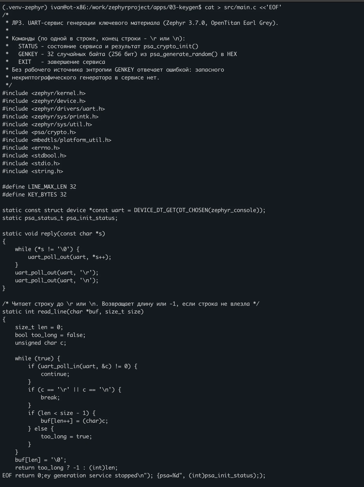

*Рисунок 2 — Создание src/main.c (наложение строк в конце — артефакт отрисовки терминала; файл проверен в контейнере: 132 строки)*

Особенности реализации:

* `read_line()` читает команду целиком до `\r` или `\n`. Лишние символы длинной строки отбрасываются, ответ — `ERR:TOO_LONG`; пустая строка (например, `\n` после `\r`) игнорируется.
* `psa_crypto_init()` вызывается один раз при старте (`CONFIG_MBEDTLS_INIT=n`, чтобы Zephyr не вызвал его раньше молча). Результат печатается в журнал и возвращается в ответе на `STATUS`, так что клиент видит, есть ли у сервиса энтропия.
* `GENKEY` без рабочего PSA отвечает ошибкой. **Запасного некриптографического генератора нет**: выдать предсказуемые байты под видом ключа хуже, чем отказать.
* После отправки ключ, его HEX-строка и буфер ответа затираются `mbedtls_platform_zeroize()`. Обычный `memset()` перед выходом из функции компилятор вправе удалить как бесполезный; эта функция гарантирует обнуление.

Сборка — 212 шагов: добавилась библиотека Mbed TLS.

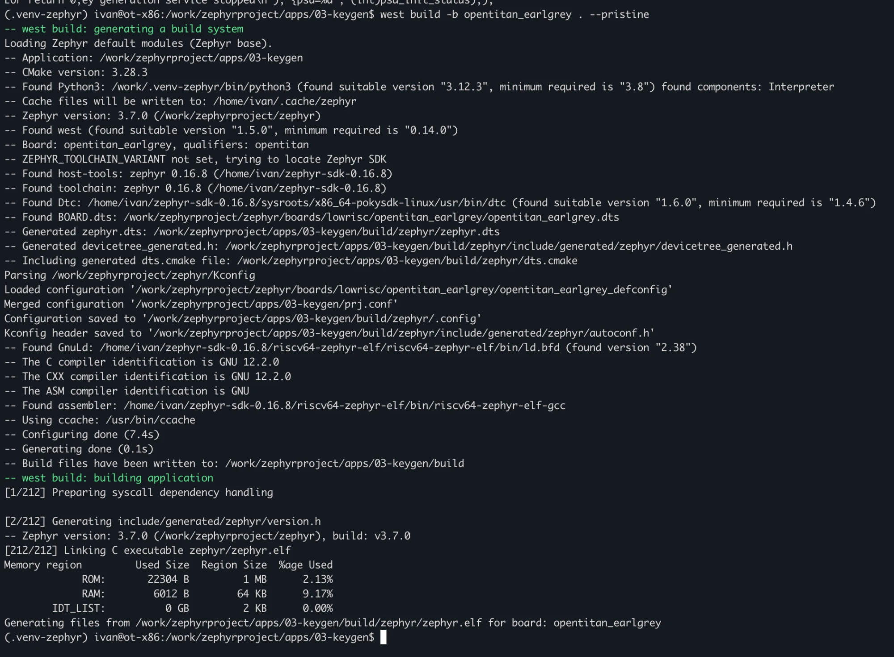

*Рисунок 3 — Сборка этапа 1: ROM 22 304 Б, RAM 6 012 Б*

Модель запускалась так же, как в работе 2, из каталога `/work/run`:

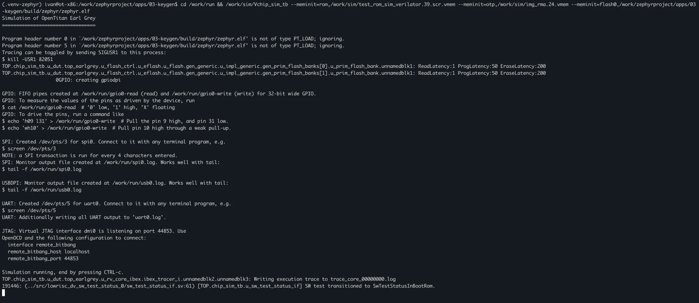

*Рисунок 4 — Запуск модели этапа 1 (UART на /dev/pts/5)*

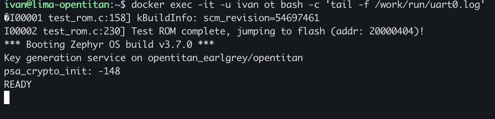

*Рисунок 5 — Журнал UART этапа 1: psa_crypto_init вернул -148*

Ошибка воспроизведена: без драйвера энтропии PSA не инициализируется. Сервис при этом работает, но на `GENKEY` будет отвечать `ERR:NO_ENTROPY psa=-148`.

---

<a id="s04"></a>

## 4. Этап 2: драйвер CSRNG

### 4.1. Как Zephyr подключает источник энтропии

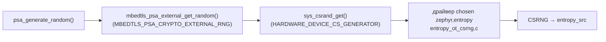

Цепочка проверена по исходникам Zephyr (`modules/mbedtls/zephyr_init.c`, `subsys/random/Kconfig`): при `CONFIG_MBEDTLS_PSA_CRYPTO_EXTERNAL_RNG` PSA не использует собственный DRBG Mbed TLS, а запрашивает байты у криптостойкого генератора Zephyr; тот по умолчанию берёт их напрямую у устройства, назначенного в Device Tree как `zephyr,entropy`. Опция `EXTERNAL_RNG` доступна только при `CSPRNG_ENABLED`, то есть при наличии драйвера (`ENTROPY_HAS_DRIVER`).

Для этого в приложение добавлены четыре файла.

**Binding** ([dts/bindings/lowrisc,opentitan-csrng.yaml](app/dts/bindings/lowrisc,opentitan-csrng.yaml)) — описание нового типа устройства для Device Tree:

```yaml
description: OpenTitan CSRNG + entropy_src (драйвер энтропии из этого приложения)

compatible: "lowrisc,opentitan-csrng"

include: base.yaml

properties:
  reg:
    required: true
```

**Overlay** ([app.overlay](app/app.overlay)) — дополнение к описанию платы: узел генератора с двумя областями регистров и назначение его источником энтропии:

```dts
/*
 * CSRNG и entropy_src OpenTitan Earl Grey (адреса из top_earlgrey.h).
 * В описании платы Zephyr 3.7 этих блоков нет, добавляем их сами.
 */
/ {
    chosen {
        zephyr,entropy = &csrng;
    };
};

&{/soc} {
    csrng: rng@41150000 {
        compatible = "lowrisc,opentitan-csrng";
        reg = <0x41150000 0x1000>, <0x41160000 0x1000>;
        reg-names = "csrng", "entropy_src";
        status = "okay";
    };
};
```

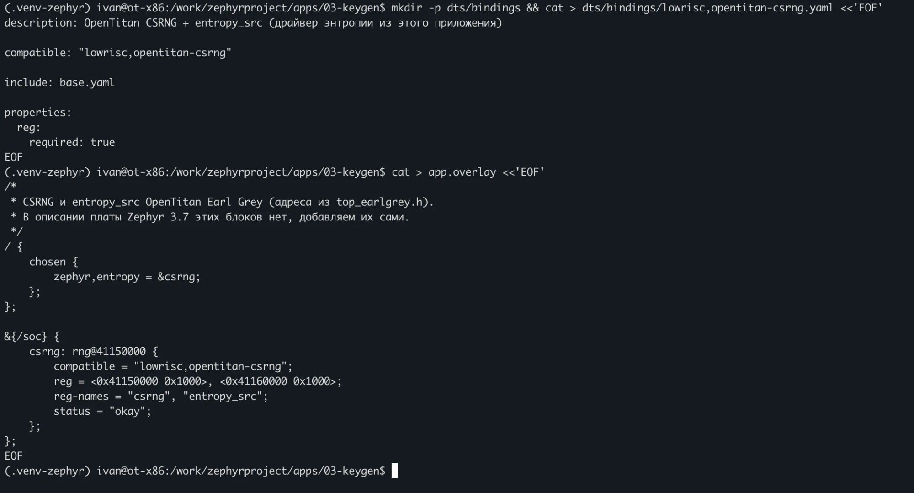

*Рисунок 6 — Создание binding и app.overlay*

**Kconfig приложения** ([Kconfig](app/Kconfig)) объявляет драйвер и сообщает системе, что настоящий источник энтропии есть (`select ENTROPY_HAS_DRIVER`):

```kconfig
# Драйвер энтропии для CSRNG OpenTitan лежит в приложении: в Zephyr 3.7 его нет
config ENTROPY_OT_CSRNG
    bool "OpenTitan CSRNG entropy driver"
    default y
    depends on ENTROPY_GENERATOR
    select ENTROPY_HAS_DRIVER

source "Kconfig.zephyr"
```

**Конфигурация этапа 2** ([prj.conf](app/prj.conf)) и сборочный файл ([CMakeLists.txt](app/CMakeLists.txt)):

```ini
# UART-консоль включена в defconfig платы
CONFIG_PRINTK=y

# PSA Crypto API, реализация из Mbed TLS
CONFIG_MBEDTLS=y
CONFIG_MBEDTLS_PSA_CRYPTO_C=y

# psa_crypto_init() вызываем сами, чтобы увидеть код результата
CONFIG_MBEDTLS_INIT=n

# Источник энтропии - наш драйвер CSRNG (src/entropy_ot_csrng.c)
CONFIG_ENTROPY_GENERATOR=y

# PSA берёт случайные байты у криптостойкого генератора Zephyr,
# а тот - у драйвера энтропии
CONFIG_MBEDTLS_PSA_CRYPTO_EXTERNAL_RNG=y
```

```cmake
cmake_minimum_required(VERSION 3.20.0)
find_package(Zephyr REQUIRED HINTS $ENV{ZEPHYR_BASE})
project(keygen)
target_sources(app PRIVATE src/main.c)
target_sources_ifdef(CONFIG_ENTROPY_OT_CSRNG app PRIVATE src/entropy_ot_csrng.c)
```

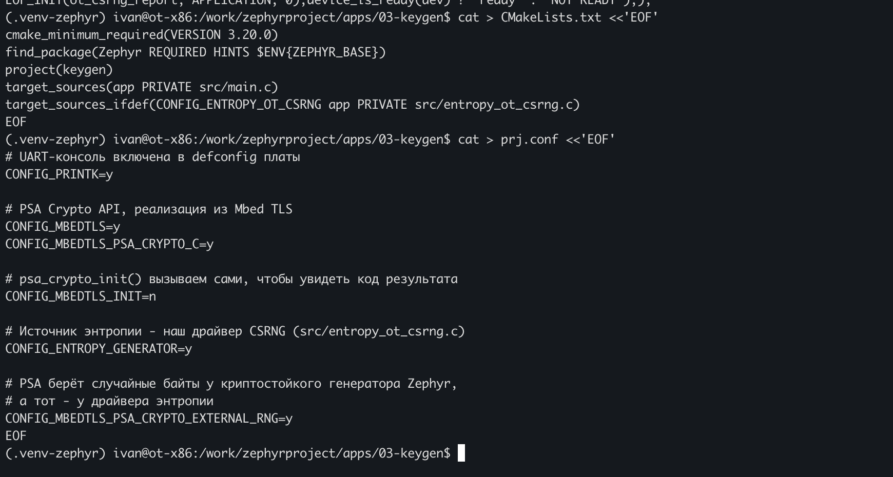

*Рисунок 7 — CMakeLists.txt и prj.conf этапа 2*

### 4.2. Драйвер

Регистры и формат команд взяты из исходников OpenTitan в контейнере: `hw/ip/csrng/data/csrng.hjson`, `hw/ip/entropy_src/data/entropy_src.hjson`, сгенерированные заголовки `csrng_regs.h`, `entropy_src_regs.h` и библиотека `sw/device/lib/dif/dif_csrng_shared.c`.

| Регистр | Смещение | Назначение |
| --- | --- | --- |
| CSRNG `CTRL` | `0x14` | включение блока и программного интерфейса |
| CSRNG `CMD_REQ` | `0x18` | заголовок команды: `acmd[3:0]`, `clen[7:4]`, `flag0[11:8]`, `glen[30:12]` |
| CSRNG `SW_CMD_STS` | `0x2c` | `CMD_RDY` (бит 1), `CMD_ACK` (бит 2), код результата `[5:3]` |
| CSRNG `GENBITS_VLD` / `GENBITS` | `0x30` / `0x34` | готовность и чтение 128-битного блока по 32 бита |
| entropy_src `MODULE_ENABLE` | `0x20` | включение |
| entropy_src `CONF` | `0x24` | режим (FIPS / boot-time), маршрутизация |
| entropy_src `ENTROPY_CONTROL` | `0x28` | куда идут данные: в CSRNG или программе |

Логические значения в этих регистрах — **многобитовые** (MuBi4): «да» = `0x6`, «нет» = `0x9`. Одиночный сбой бита не может превратить «выключено» во «включено» — это защита от атак внесением сбоев, характерная для OpenTitan.

Итоговая версия драйвера [src/entropy_ot_csrng.c](app/src/entropy_ot_csrng.c):

```c
/*
 * Драйвер энтропии Zephyr для CSRNG OpenTitan Earl Grey.
 *
 * В Zephyr 3.7 такого драйвера нет, поэтому он лежит в приложении.
 * Порядок включения повторяет криптобиблиотеку OpenTitan
 * (sw/device/lib/crypto/drivers/entropy.c): entropy_src в FIPS-режиме
 * с аппаратным кондиционированием, данные идут в CSRNG; затем CSRNG и
 * команда Instantiate с затравкой из entropy_src. get_entropy() выдаёт
 * результат команды Generate блоками по 128 бит.
 * Регистры - csrng.hjson и entropy_src.hjson (OpenTitan earlgrey_1.0.0).
 */
#define DT_DRV_COMPAT lowrisc_opentitan_csrng

#include <zephyr/kernel.h>
#include <zephyr/device.h>
#include <zephyr/drivers/entropy.h>
#include <zephyr/init.h>
#include <zephyr/sys/printk.h>
#include <zephyr/sys/sys_io.h>
#include <zephyr/sys/util.h>
#include <errno.h>
#include <string.h>

/* CSRNG */
#define CSRNG_CTRL            0x14
#define CSRNG_CMD_REQ         0x18
#define CSRNG_SW_CMD_STS      0x2c
#define CSRNG_GENBITS_VLD     0x30
#define CSRNG_GENBITS         0x34
#define CSRNG_RECOV_ALERT_STS 0x50
#define CSRNG_ERR_CODE        0x54
#define CSRNG_MAIN_SM_STATE   0x5c
#define CSRNG_CTRL_RESVAL     0x9999

#define STS_CMD_RDY      BIT(1)
#define STS_CMD_ACK      BIT(2)
#define STS_CMD_STS(reg) (((reg) >> 3) & 0x7)
#define GENBITS_VLD      BIT(0)

/* entropy_src */
#define ES_MODULE_ENABLE   0x20
#define ES_CONF            0x24
#define ES_ENTROPY_CONTROL 0x28
#define ES_DEBUG_STATUS    0xd0
#define ES_RECOV_ALERT_STS 0xd4
#define ES_ERR_CODE        0xd8
#define ES_MAIN_SM_STATE   0xe0

/* Многобитовые булевы значения OpenTitan */
#define MUBI4_TRUE  0x6
#define MUBI4_FALSE 0x9

/* CONF: FIPS_ENABLE[3:0], FIPS_FLAG[7:4], RNG_FIPS[11:8], RNG_BIT_ENABLE[15:12],
 * THRESHOLD_SCOPE[21:18], ENTROPY_DATA_REG_ENABLE[25:22] */
#define ES_CONF_FIPS (MUBI4_TRUE | (MUBI4_TRUE << 4) | (MUBI4_TRUE << 8) | \
                      (MUBI4_FALSE << 12) | (MUBI4_FALSE << 18) | (MUBI4_FALSE << 22))
/* ENTROPY_CONTROL: ES_ROUTE = false (в CSRNG), ES_TYPE = false (с кондиционированием) */
#define ES_CONTROL_HW (MUBI4_FALSE | (MUBI4_FALSE << 4))
/* CSRNG CTRL: ENABLE, SW_APP_ENABLE, READ_INT_STATE = true; FIPS_FORCE_ENABLE = false */
#define CSRNG_CTRL_ON (MUBI4_TRUE | (MUBI4_TRUE << 4) | (MUBI4_TRUE << 8) | (MUBI4_FALSE << 12))

/* Заголовок команды: acmd[3:0], clen[7:4], flag0[11:8], glen[30:12].
 * flag0 = false - затравка берётся из entropy_src */
#define CMD_INSTANTIATE 1
#define CMD_GENERATE    3
#define CMD_HEADER(acmd, glen) ((acmd) | (MUBI4_FALSE << 8) | ((uint32_t)(glen) << 12))

#define MAX_GEN_BLOCKS 0x800  /* предел NIST SP 800-90A на одну команду */
#define POLL_LIMIT     200000

struct ot_csrng_config {
    mm_reg_t csrng;
    mm_reg_t es;
};

/* Состояние регистров после запуска - для журнала */
static struct {
    int init_ret;
    uint32_t es_sm, es_dbg, es_recov, es_err;
    uint32_t cs_sts, cs_sm, cs_recov, cs_err;
} diag;

static int wait_bits(mm_reg_t reg, uint32_t mask)
{
    for (int i = 0; i < POLL_LIMIT; i++) {
        if ((sys_read32(reg) & mask) == mask) {
            return 0;
        }
    }
    return -ETIMEDOUT;
}

static int send_cmd(const struct ot_csrng_config *cfg, uint32_t header)
{
    if (wait_bits(cfg->csrng + CSRNG_SW_CMD_STS, STS_CMD_RDY) != 0) {
        return -ETIMEDOUT;
    }
    sys_write32(header, cfg->csrng + CSRNG_CMD_REQ);
    return 0;
}

static int wait_ack(const struct ot_csrng_config *cfg)
{
    if (wait_bits(cfg->csrng + CSRNG_SW_CMD_STS, STS_CMD_ACK) != 0) {
        return -ETIMEDOUT;
    }
    return STS_CMD_STS(sys_read32(cfg->csrng + CSRNG_SW_CMD_STS)) == 0 ? 0 : -EIO;
}

/* Одна команда Generate на n байт (не больше MAX_GEN_BLOCKS блоков) */
static int generate(const struct ot_csrng_config *cfg, uint8_t *buf, size_t n)
{
    size_t blocks = DIV_ROUND_UP(n, 16);
    uint32_t words[4];
    int ret;

    ret = send_cmd(cfg, CMD_HEADER(CMD_GENERATE, blocks));
    if (ret != 0) {
        return ret;
    }

    for (size_t b = 0; b < blocks; b++) {
        size_t chunk = MIN(n, sizeof(words));

        if (wait_bits(cfg->csrng + CSRNG_GENBITS_VLD, GENBITS_VLD) != 0) {
            return -ETIMEDOUT;
        }
        for (int i = 0; i < 4; i++) {
            words[i] = sys_read32(cfg->csrng + CSRNG_GENBITS);
        }
        memcpy(buf, words, chunk);
        buf += chunk;
        n -= chunk;
    }
    memset(words, 0, sizeof(words));

    return wait_ack(cfg);
}

static int ot_csrng_get_entropy(const struct device *dev, uint8_t *buf, uint16_t len)
{
    const struct ot_csrng_config *cfg = dev->config;

    while (len > 0) {
        size_t n = MIN(len, MAX_GEN_BLOCKS * 16);
        int ret = generate(cfg, buf, n);

        if (ret != 0) {
            return ret;
        }
        buf += n;
        len -= n;
    }
    return 0;
}

static void save_diag(const struct ot_csrng_config *cfg, int ret)
{
    diag.init_ret = ret;
    diag.es_sm = sys_read32(cfg->es + ES_MAIN_SM_STATE);
    diag.es_dbg = sys_read32(cfg->es + ES_DEBUG_STATUS);
    diag.es_recov = sys_read32(cfg->es + ES_RECOV_ALERT_STS);
    diag.es_err = sys_read32(cfg->es + ES_ERR_CODE);
    diag.cs_sts = sys_read32(cfg->csrng + CSRNG_SW_CMD_STS);
    diag.cs_sm = sys_read32(cfg->csrng + CSRNG_MAIN_SM_STATE);
    diag.cs_recov = sys_read32(cfg->csrng + CSRNG_RECOV_ALERT_STS);
    diag.cs_err = sys_read32(cfg->csrng + CSRNG_ERR_CODE);
}

static int ot_csrng_init(const struct device *dev)
{
    const struct ot_csrng_config *cfg = dev->config;
    int ret;

    /* Остановить оба блока: настраивать entropy_src можно только выключенным */
    sys_write32(CSRNG_CTRL_RESVAL, cfg->csrng + CSRNG_CTRL);
    sys_write32(MUBI4_FALSE, cfg->es + ES_MODULE_ENABLE);

    /* entropy_src: FIPS-режим, данные в CSRNG; окна и пороги тестов - по умолчанию */
    sys_write32(ES_CONTROL_HW, cfg->es + ES_ENTROPY_CONTROL);
    sys_write32(ES_CONF_FIPS, cfg->es + ES_CONF);
    sys_write32(0, cfg->es + ES_RECOV_ALERT_STS);
    sys_write32(MUBI4_TRUE, cfg->es + ES_MODULE_ENABLE);

    sys_write32(0, cfg->csrng + CSRNG_RECOV_ALERT_STS);
    sys_write32(CSRNG_CTRL_ON, cfg->csrng + CSRNG_CTRL);

    ret = send_cmd(cfg, CMD_HEADER(CMD_INSTANTIATE, 0));
    if (ret == 0) {
        ret = wait_ack(cfg);
    }
    save_diag(cfg, ret);
    return ret;
}

static const struct entropy_driver_api ot_csrng_api = {
    .get_entropy = ot_csrng_get_entropy,
};

static const struct ot_csrng_config ot_csrng_cfg = {
    .csrng = DT_INST_REG_ADDR_BY_NAME(0, csrng),
    .es = DT_INST_REG_ADDR_BY_NAME(0, entropy_src),
};

DEVICE_DT_INST_DEFINE(0, ot_csrng_init, NULL, NULL, &ot_csrng_cfg,
                      PRE_KERNEL_1, CONFIG_ENTROPY_INIT_PRIORITY, &ot_csrng_api);

/* Перед main() сообщаем в журнал, запустился ли драйвер, и состояние блоков */
static int ot_csrng_report(void)
{
    const struct device *dev = DEVICE_DT_INST_GET(0);

    printk("Entropy: %s %s (init %d)\n", dev->name,
           device_is_ready(dev) ? "ready" : "NOT READY", diag.init_ret);
    printk("  entropy_src: sm=0x%03x dbg=0x%08x recov=0x%x err=0x%x\n",
           diag.es_sm, diag.es_dbg, diag.es_recov, diag.es_err);
    printk("  csrng: sts=0x%x sm=0x%03x recov=0x%x err=0x%x\n",
           diag.cs_sts, diag.cs_sm, diag.cs_recov, diag.cs_err);
    return 0;
}
SYS_INIT(ot_csrng_report, APPLICATION, 0);
```

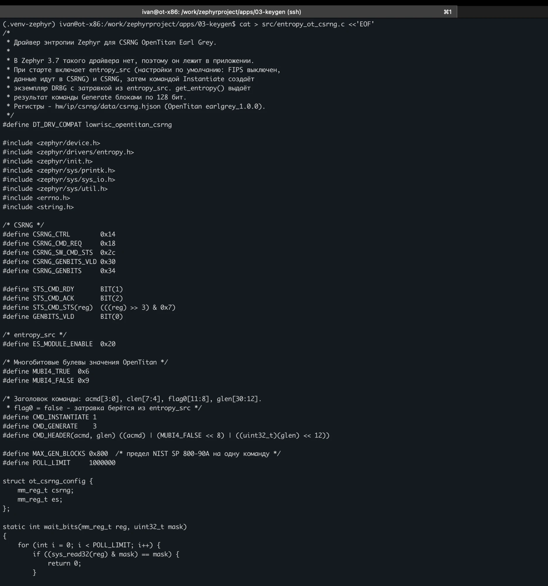

*Рисунок 8 — Создание драйвера (версия 1; отличия версии 2 описаны в разделе 4.5)*

Как работает драйвер:

1. `ot_csrng_init()` (уровень `PRE_KERNEL_1`, до инициализации PSA) выключает оба блока, настраивает `entropy_src` и включает его, затем включает CSRNG и отправляет команду **Instantiate** (`acmd=1`, `flag0=false` — затравка из `entropy_src`), дожидаясь `CMD_ACK` и нулевого кода результата.
2. `ot_csrng_get_entropy()` отправляет **Generate** на нужное число 128-битных блоков (не больше `0x800` за команду — предел NIST SP 800-90A), читает каждый блок четырьмя словами из `GENBITS` после флага `GENBITS_VLD` и ждёт подтверждения команды.
3. Каждое ожидание ограничено `POLL_LIMIT`: при неисправности драйвер возвращает `-ETIMEDOUT`, а не зависает навсегда.
4. Состояние регистров обоих блоков сохраняется после запуска и печатается перед `main()` функцией `ot_csrng_report()`.

### 4.3. Ошибка сборки: `sys_read32`

Первая сборка остановилась на компоновке:

```text
warning: implicit declaration of function 'sys_read32'
undefined reference to `sys_read32'
```

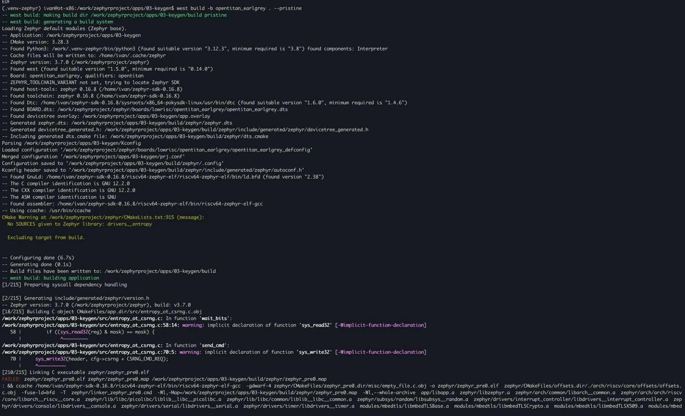

*Рисунок 9 — Неявное объявление sys_read32/sys_write32*

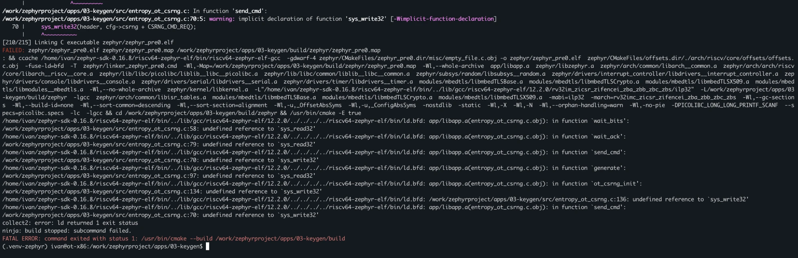

*Рисунок 10 — Ошибка компоновки: undefined reference to sys_read32*

Заголовок `<zephyr/sys/sys_io.h>` содержит только типы. Сами встраиваемые функции доступа к регистрам для RISC-V находятся в `<zephyr/arch/riscv/sys_io.h>` и подключаются через `<zephyr/arch/cpu.h>`, который включает `<zephyr/kernel.h>`. Исправление — одна строка `#include <zephyr/kernel.h>`.

Та же сборка показала, что остальная проводка верна: Zephyr прочитал `Kconfig` приложения, подхватил `app.overlay`, скомпилировал драйвер и подключил подсистему случайных чисел. Предупреждение CMake `No SOURCES given to Zephyr library: drivers__entropy` безвредно: подсистема драйверов энтропии включена, но встроенных драйверов для этой платы в Zephyr нет — наш находится в приложении.

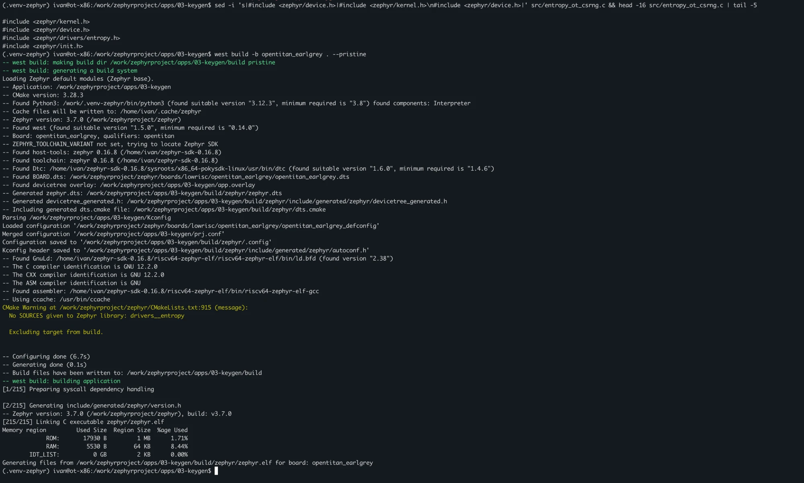

*Рисунок 11 — Сборка после исправления: ROM 17 930 Б, RAM 5 530 Б*

### 4.4. Первый запуск: CSRNG не подтверждает команду

Журнал остановился на строке test ROM, баннер Zephyr не появился: драйвер инициализируется раньше баннера и ждал ответа CSRNG.

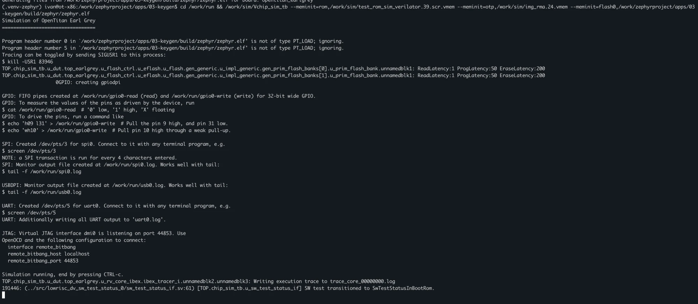

*Рисунок 12 — Запуск модели с первой версией драйвера*

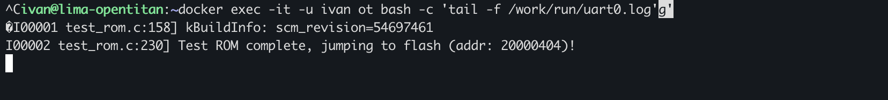

*Рисунок 13 — Журнал UART: после перехода во флеш ничего не выводится*

Причину нашли по трассе процессора Ibex, которую модель пишет в `trace_core_00000000.log`. Последние строки:

```text
c.lw    x14,0(x10)    x10:0x4115002c  x14=0x00000002  load:0x00000002
c.and   x14,x11       x14:0x00000002  x11:0x00000004  x14=0x00000000
beq     x14,x11,...
c.addi  x15,-1        (счётчик POLL_LIMIT)
```

Процессор крутится в `wait_bits()` и читает `SW_CMD_STS` (`0x4115_002c`) = `0x2`: `CMD_RDY = 1`, `CMD_ACK = 0`. По RTL (`hw/ip/csrng/rtl/csrng_core.sv`) `CMD_RDY` равен 1 только при включённом CSRNG. Значит, CSRNG включён и команду принял, но Instantiate не выполнен: он ждёт затравку от `entropy_src`. За 1,33 млн тактов (около 6 минут моделирования, ~3,7 тыс. тактов в секунду) подтверждения не было.

### 4.5. Версия 2: настройка как в криптобиблиотеке OpenTitan

Сравнение с криптобиблиотекой OpenTitan (`sw/device/lib/crypto/drivers/entropy.c`) показало отличие: первая версия оставляла `entropy_src` в режиме по умолчанию (boot-time / bypass), а библиотека явно записывает `ENTROPY_CONTROL`, переводит `CONF` в FIPS-режим (`FIPS_ENABLE`, `FIPS_FLAG`, `RNG_FIPS` = true), сбрасывает флаги тревог и только затем включает блок; CSRNG включается с `READ_INT_STATE = true`. Окна и пороги тестов здоровья по умолчанию совпадают с её настройками.

Изменения версии 2:

* оба блока сначала выключаются (конфигурация `entropy_src` принимается только у выключенного блока);
* настройка `entropy_src` и CSRNG повторяет криптобиблиотеку;
* добавлено сохранение и печать диагностики регистров;
* `POLL_LIMIT` уменьшен до 200 000 опросов, чтобы при неудаче драйвер сдавался за несколько минут.

Кроме того, модель запускалась с параметром `+rng_srate_value=5`. Модель источника шума в AST (`hw/top_earlgrey/ip/ast/rtl/rng.sv`) по умолчанию выдаёт 4 бита раз в 32–128 тактов `clk_io_div4`; параметр сокращает интервал до 5 тактов. Модель передаёт такие параметры в Verilator (`Verilated::commandArgs`), где их читает `$value$plusargs`.

```bash
/work/sim/Vchip_sim_tb +rng_srate_value=5 --meminit=rom,... --meminit=otp,... --meminit=flash0,.../03-keygen/build/zephyr/zephyr.elf
```

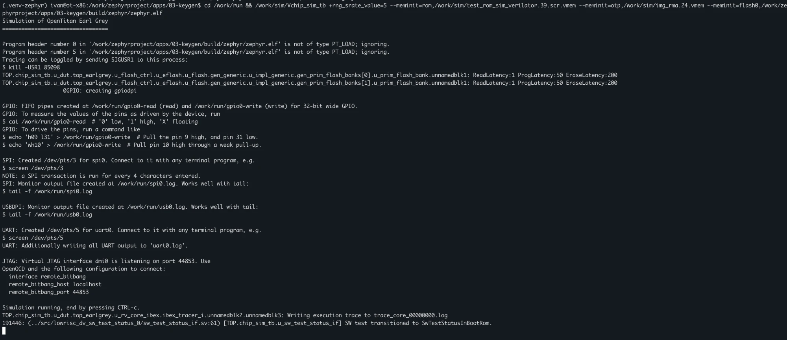

*Рисунок 14 — Запуск модели с драйвером версии 2 и +rng_srate_value=5*

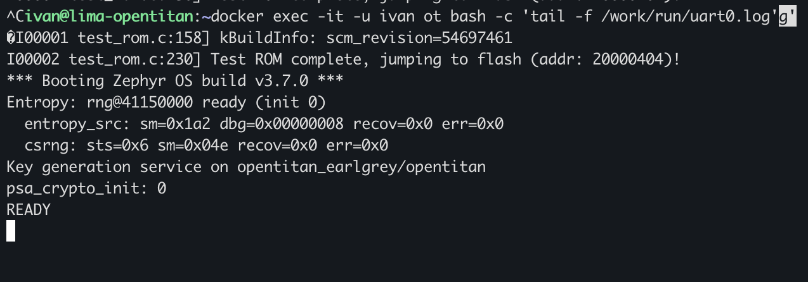

*Рисунок 15 — Драйвер готов, psa_crypto_init вернул 0*

```text
Entropy: rng@41150000 ready (init 0)
  entropy_src: sm=0x1a2 dbg=0x00000008 recov=0x0 err=0x0
  csrng: sts=0x6 sm=0x04e recov=0x0 err=0x0
psa_crypto_init: 0
READY
```

| Поле | Значение | Расшифровка (по RTL OpenTitan) |
| --- | --- | --- |
| entropy_src `MAIN_SM_STATE` | `0x1a2` | `ContHTRunning` — FIPS-режим, непрерывные тесты здоровья (`entropy_src_main_sm_pkg.sv`) |
| CSRNG `SW_CMD_STS` | `0x6` | `CMD_RDY` и `CMD_ACK`, код результата 0 — Instantiate выполнен |
| CSRNG `MAIN_SM_STATE` | `0x04e` | `MainSmIdle` — ожидание команд (`csrng_pkg.sv`) |
| `RECOV_ALERT_STS`, `ERR_CODE` | `0` | тревог и ошибок нет |

Какое из двух изменений — FIPS-настройка или ускорение модели генератора — устранило зависание, отдельно не проверялось: оба сделаны в одном запуске.

---

<a id="s05"></a>

## 5. Хост-клиент

Исходный код [host_client.py](app/host_client.py):

```python
#!/usr/bin/env python3
"""ЛР3. Хост-клиент для проверки сервиса генерации ключей в модели OpenTitan.

Использование: python3 host_client.py /dev/pts/N
"""
import re
import sys
import time

import serial

TIMEOUT = 60.0   # секунд на ответ: модель под Rosetta работает медленно
KEY_COUNT = 3    # сколько ключей запросить
KEY_RE = re.compile(r"KEY:([0-9a-f]{64})")


def command(ser, cmd):
    """Отправляет команду, возвращает строку ответа без \\r\\n и время ответа."""
    start = time.monotonic()
    ser.write(cmd.encode() + b"\r\n")
    line = bytearray()
    while time.monotonic() < start + TIMEOUT and not line.endswith(b"\r\n"):
        line += ser.read(ser.in_waiting or 1)
    return line.decode(errors="replace").strip(), time.monotonic() - start


def check(name, ok, detail=""):
    print(f"[{'PASS' if ok else 'FAIL'}] {name}" + (f": {detail}" if detail else ""))
    return ok


def main():
    if len(sys.argv) != 2:
        print(f"Использование: {sys.argv[0]} /dev/pts/N")
        return 1

    ser = serial.Serial(sys.argv[1], baudrate=115200, timeout=0.2)
    ser.reset_input_buffer()  # отбросить журнал загрузки
    results = []

    resp, _ = command(ser, "STATUS")
    results.append(check("STATUS", resp == "OK:READY psa=0", resp))

    keys = []
    for i in range(KEY_COUNT):
        resp, dt = command(ser, "GENKEY")
        m = KEY_RE.fullmatch(resp)
        if m:
            keys.append(bytes.fromhex(m.group(1)))
        results.append(check(f"GENKEY #{i + 1}", m is not None, f"{resp} ({dt:.1f} с)"))

    if len(keys) == KEY_COUNT:
        results.append(check("ключи различаются", len(set(keys)) == KEY_COUNT))
        ones = sum(bin(b).count("1") for k in keys for b in k)
        bits = 8 * len(keys[0]) * KEY_COUNT
        print(f"       {len(keys[0])} байта = {8 * len(keys[0])} бит на ключ; "
              f"единиц {ones} из {bits} ({100 * ones / bits:.1f} %)")

    resp, _ = command(ser, "HELLO")
    results.append(check("неизвестная команда", resp == "ERR:UNKNOWN_CMD", resp))

    resp, _ = command(ser, "A" * 40)
    results.append(check("слишком длинная команда", resp == "ERR:TOO_LONG", resp))

    resp, _ = command(ser, "EXIT")
    results.append(check("EXIT", resp == "OK:BYE", resp))

    ser.close()
    failed = results.count(False)
    print("ALL TESTS PASSED" if failed == 0 else f"FAILED: {failed}")
    return 0 if failed == 0 else 2


if __name__ == "__main__":
    sys.exit(main())
```

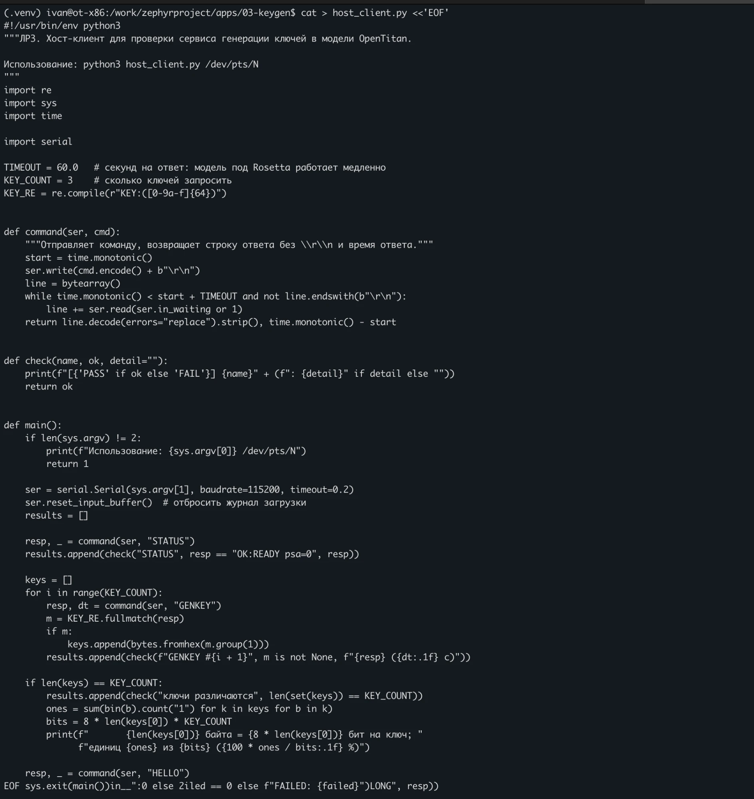

*Рисунок 16 — Создание клиента (наложение строк в конце — артефакт отрисовки терминала)*

| № | Проверка | Отправлено | Ожидается |
| :---: | --- | --- | --- |
| 1 | Готовность | `STATUS` | `OK:READY psa=0` |
| 2–4 | Генерация | `GENKEY` × 3 | `KEY:` и ровно 64 hex-символа (32 байта) |
| 5 | Различие ключей | — | три ключа попарно различны |
| 6 | Неизвестная команда | `HELLO` | `ERR:UNKNOWN_CMD` |
| 7 | Длинная строка | 40 × `A` | `ERR:TOO_LONG` |
| 8 | Завершение | `EXIT` | `OK:BYE` |

Дополнительно клиент считает долю единичных битов в полученных ключах. Это лишь проверка на грубую неисправность (например, генератор выдаёт нули или повторяет значение), а не доказательство случайности.

---

<a id="s06"></a>

## 6. Результаты

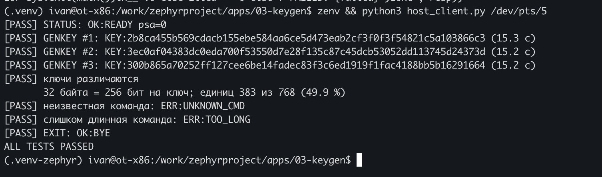

*Рисунок 17 — Все проверки клиента пройдены*

```text
[PASS] STATUS: OK:READY psa=0
[PASS] GENKEY #1: KEY:2b8ca455b569cdacb155ebe584aa6ce5d473eab2cf3f0f3f54821c5a103866c3 (15.3 с)
[PASS] GENKEY #2: KEY:3ec0af04383dc0eda700f53550d7e28f135c87c45dcb53052dd113745d24373d (15.2 с)
[PASS] GENKEY #3: KEY:300b865a70252ff127cee6be14fadec83f3c6ed1919f1fac4188bb5b16291664 (15.2 с)
[PASS] ключи различаются
       32 байта = 256 бит на ключ; единиц 383 из 768 (49.9 %)
[PASS] неизвестная команда: ERR:UNKNOWN_CMD
[PASS] слишком длинная команда: ERR:TOO_LONG
[PASS] EXIT: OK:BYE
ALL TESTS PASSED
```

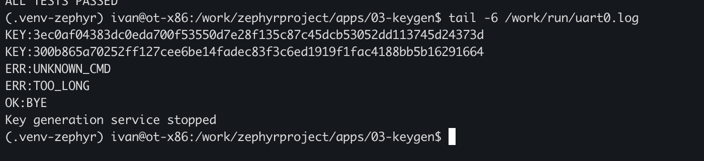

*Рисунок 18 — Журнал UART после проверок*

Журнал UART целиком — [results/uart0.log](results/uart0.log).

| Проверка | Результат | Вывод |
| --- | --- | --- |
| Драйвер CSRNG | `ready (init 0)`, тревог и ошибок нет | аппаратный генератор модели включён программно |
| `psa_crypto_init()` | `0` | PSA получил источник энтропии |
| `STATUS` | `OK:READY psa=0` | клиент видит состояние криптоподсистемы |
| `GENKEY` × 3 | 64 hex-символа = 32 байта = 256 бит | формат соответствует ключу AES-256 |
| Различие ключей | 3 разных значения, 49,9 % единиц | грубых неисправностей генератора нет |
| `HELLO`, 40 × `A` | `ERR:UNKNOWN_CMD`, `ERR:TOO_LONG` | ошибочный ввод обрабатывается |
| `EXIT` | `OK:BYE`, `Key generation service stopped` | сервис завершён |

Около 15 секунд на ключ уходит в основном на передачу 70 символов ответа по UART модели (~5 байт/с, как в работе 2); сама генерация 32 байт — две 128-битные выборки CSRNG — занимает малую долю этого времени.

---

<a id="s07"></a>

## 7. Размер прошивки

| Сборка | ROM | RAM |
| --- | ---: | ---: |
| Эхо-сервис (работа 2) | 14 748 Б | 4 208 Б |
| Этап 1: PSA, собственный DRBG Mbed TLS (`LEGACY_RNG`) | 22 304 Б | 6 012 Б |
| Этап 2: PSA + драйвер CSRNG (`EXTERNAL_RNG`), версия 1 | 17 930 Б | 5 530 Б |

С внешним источником случайности прошивка стала **меньше**, чем на этапе 1: при `MBEDTLS_PSA_CRYPTO_LEGACY_RNG` Kconfig Mbed TLS включает модуль сбора энтропии и HMAC-DRBG, а при `EXTERNAL_RNG` их функцию выполняет аппаратный CSRNG, и эти модули в сборку не попадают.

---

<a id="s08"></a>

## 8. Проблемы и решения

| Проблема | Причина | Решение |
| --- | --- | --- |
| `psa_crypto_init() = -148` | В Zephyr 3.7 нет драйвера энтропии для OpenTitan и узлов генератора в Device Tree | Собственный драйвер CSRNG в приложении: binding, overlay, Kconfig, `entropy_ot_csrng.c` |
| `CONFIG_PSA_CRYPTO` не существует | В Zephyr 3.7 PSA включается через Mbed TLS | `CONFIG_MBEDTLS=y`, `CONFIG_MBEDTLS_PSA_CRYPTO_C=y` |
| `implicit declaration of 'sys_read32'` | Функции доступа к регистрам объявлены в заголовках архитектуры, а не в `sys/sys_io.h` | `#include <zephyr/kernel.h>` |
| CSRNG не подтверждает Instantiate | `entropy_src` не выдавал затравку в режиме по умолчанию (найдено по трассе Ibex) | Настройка как в криптобиблиотеке OpenTitan (FIPS-режим) и запуск с `+rng_srate_value=5` |
| Драйвер не записался: `No such file or directory` | Команда выполнялась в `/work/run` после запуска модели | Переход в каталог приложения перед созданием файлов |

---

<a id="s09"></a>

## 9. Ограничения и безопасность

* **Энтропия в модели — не физическая.** В Verilator модель AST заменяет аналоговый источник шума генератором на LFSR с фиксированной начальной точкой (`hw/top_earlgrey/ip/ast/rtl/rng.sv`). Работа подтверждает программно-аппаратную цепочку PSA → драйвер → CSRNG → entropy_src, но не непредсказуемость ключей: при одинаковом запуске последовательность, по всей видимости, повторится (не проверялось). На кристалле на месте LFSR стоит физический источник шума.
* **Режим FIPS отмечен программно.** Флаг `FIPS_FLAG` установлен по образцу криптобиблиотеки; соответствие настроек требованиям сертификации не оценивалось.
* **Без повторного засева.** Драйвер выполняет Instantiate один раз и не выдаёт команду Reseed; для длительной работы её нужно добавить.
* **Отказ вместо замены.** При неисправном источнике `GENKEY` возвращает ошибку; тестового генератора в сборке нет.
* **Ключ покидает чип открытым текстом.** Сервис учебный: ключ передаётся по UART в HEX. В реальном корне доверия ключ остаётся внутри (например, в хранилище ключей PSA или keymgr OpenTitan) и не выводится.
* **Статистика ограничена.** Три ключа и доля единиц 49,9 % исключают только грубые неисправности; статистические тесты (NIST SP 800-22 и др.) не проводились.

---

<a id="s10"></a>

## 10. Повторный запуск

1. В контейнере: `zenv`, `cd /work/zephyrproject/apps/03-keygen`.
2. `west build -b opentitan_earlgrey . --pristine`.
3. Убедиться, что старых моделей нет: `pgrep -a Vchip_sim_tb`.
4. Из `/work/run` запустить модель с `+rng_srate_value=5` и найти номер PTY в строке `UART: Created /dev/pts/N`.
5. Дождаться в `uart0.log` строк `Entropy: … ready (init 0)`, `psa_crypto_init: 0`, `READY`.
6. `python3 host_client.py /dev/pts/N`.
7. Остановить модель через Ctrl+C и удалить `/work/run/trace_core_00000000.log`.

---

<a id="s11"></a>

## 11. Заключение

Разработан UART-сервис генерации ключевого материала на Zephyr RTOS 3.7.0 с PSA Crypto API и Python-клиент для его проверки.

Причина ошибки `PSA_ERROR_INSUFFICIENT_ENTROPY` (`-148`) установлена по исходникам: в Zephyr 3.7 нет драйвера энтропии для OpenTitan, хотя в чипе есть комплекс `entropy_src` → `CSRNG`. Ошибка воспроизведена на этапе 1.

На этапе 2 написан драйвер энтропии Zephyr для CSRNG OpenTitan, подключённый через Device Tree overlay, binding и Kconfig приложения. Зависание первой версии диагностировано по трассе процессора Ibex и устранено настройкой `entropy_src` по образцу криптобиблиотеки OpenTitan. В итоге `psa_crypto_init()` вернул 0, а `psa_generate_random()` получает данные из аппаратного генератора модели.

Клиент выполнил 8 проверок — `STATUS`, три `GENKEY` в формате 64 hex-символа (32 байта, 256 бит), различие ключей, неизвестную и слишком длинную команду, `EXIT` — все пройдены.

Ограничение работы: в модели источник шума — LFSR, поэтому подтверждена работоспособность цепочки генерации, но не криптостойкость полученных значений.

---

<a id="s12"></a>

## 12. Источники

1. [OpenTitan — CSRNG](https://opentitan.org/book/hw/ip/csrng/index.html) и [ENTROPY_SRC](https://opentitan.org/book/hw/ip/entropy_src/index.html), а также исходники ветки `earlgrey_1.0.0`: `hw/ip/csrng`, `hw/ip/entropy_src`, `sw/device/lib/crypto/drivers/entropy.c`.
2. [Zephyr 3.7.0 — PSA Crypto](https://docs.zephyrproject.org/3.7.0/services/crypto/psa_crypto.html).
3. [Zephyr 3.7.0 — Entropy API](https://docs.zephyrproject.org/3.7.0/hardware/peripherals/entropy.html) и [Random Number Generation](https://docs.zephyrproject.org/3.7.0/services/crypto/random/index.html).
4. [Arm PSA Certified Crypto API](https://arm-software.github.io/psa-api/crypto/) — коды ошибок, в том числе `PSA_ERROR_INSUFFICIENT_ENTROPY`.
5. NIST SP 800-90A Rev. 1 — Recommendation for Random Number Generation Using Deterministic Random Bit Generators.

---

[К списку практических работ](../../README.md)
